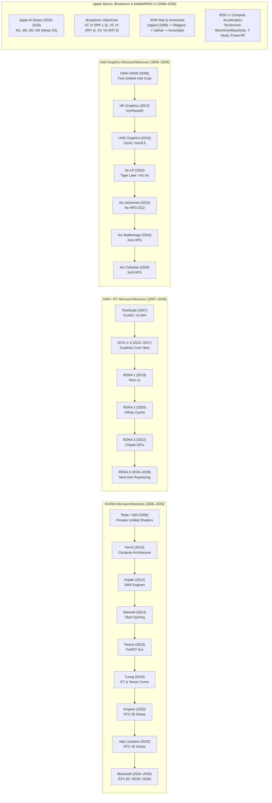
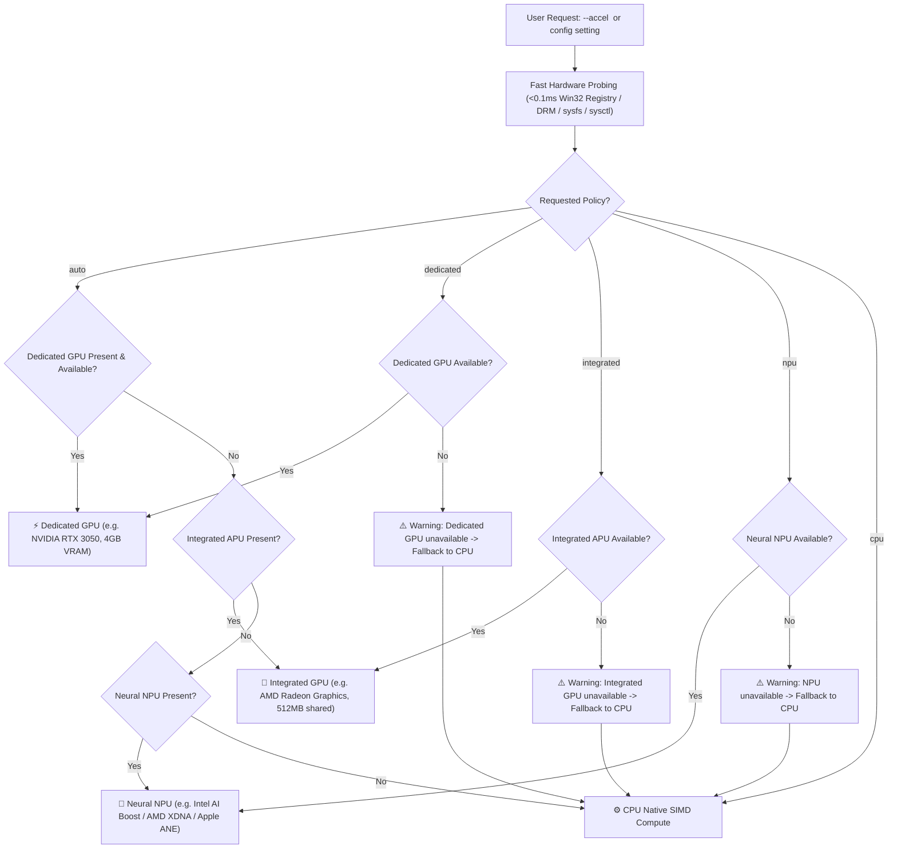
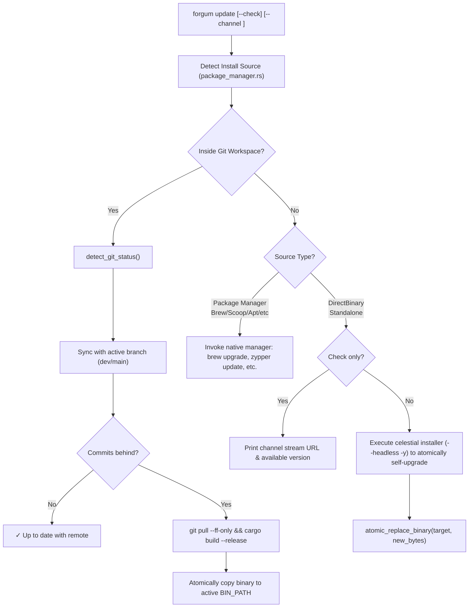
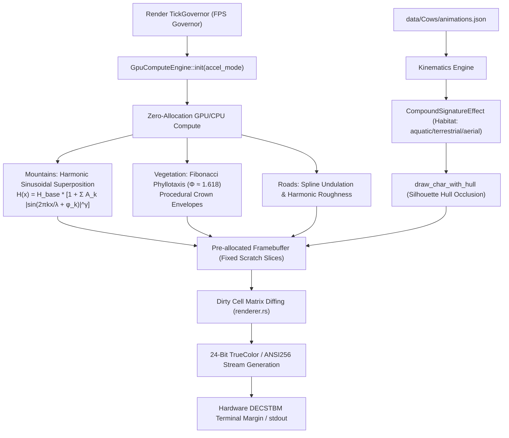
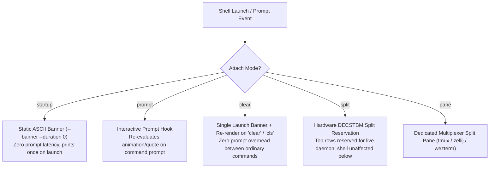

# Forgum Master Architecture & Codebase Map (`ARCHITECTURE_MAP.md`)

> **MANDATORY DIRECTIVE FOR ALL AI AGENTS**:
> Before executing broad searches with `ripgrep`, `grep`, or exploratory find commands, agents **MUST** inspect this document.
> It contains the authoritative map of all file locations, key functions, data structures, execution pipelines, keyword indices, and graphical Mermaid mind maps for the entire Forgum repository.

---

## 1. Master System Topology Mind Map

```mermaid
graph TD
    CLI_BIN["forgum (Binary Entry: crates/engine/src/main.rs)"] --> CLI_PARSE["crates/engine/src/cli.rs (Clap Parser)"]
    CLI_PARSE --> RUNNER["crates/engine/src/runner.rs (Central Command Dispatcher)"]

    subgraph Command_Dispatch ["Command Dispatcher (crates/engine/src/runner.rs)"]
        RUNNER -->|render / anim / banner| CORE["crates/engine/src/engine_core.rs"]
        RUNNER -->|update / upgrade| UPDATE["runner::handle_update_command"]
        RUNNER -->|status| STATUS["runner::handle_status_command"]
        RUNNER -->|checkhealth| HEALTH["crates/engine/src/checkhealth.rs"]
        RUNNER -->|init <shell>| SHELL["crates/engine/src/shell.rs"]
        RUNNER -->|config --tui| TUI["crates/tui/src/app.rs (Tabs 1-6)"]
        RUNNER -->|fetch| FETCH["crates/engine/src/fetch.rs (Instant & 240Hz Live Metrics)"]
        RUNNER -->|telemetry report| TELEM["crates/engine/src/telemetry_bus.rs (Shell Event Bus)"]
        RUNNER -->|status-line| MUX_WIDGET["crates/engine/src/kitty.rs & status_line.rs (Tmux/Zellij)"]
        RUNNER -->|battle / rps-battle| BATTLE["crates/engine/src/battle.rs & rps.rs"]
        RUNNER -->|stop / sweep| STOP["runner::handle_stop_command"]
    end

    subgraph Platform_Layer ["crates/platform (Hardware, OS & System Abstraction)"]
        CORE --> TERM["src/terminal.rs (Raw Mode, DECSTBM Margins, TrueColor)"]
        CORE --> SIG["src/signals.rs (RAII Guards, SIGWINCH, Ctrl+C)"]
        RUNNER --> PROC["src/process.rs & daemon_state_path"]
        RUNNER --> CONF["src/config.rs (JSON / TOML / YAML)"]
        RUNNER --> GPU_PLAT["src/gpu.rs (Hardware GPU Probing & 2006-2026 Taxonomy)"]
        GPU_PLAT --> REG_WIN["src/platform_windows.rs (Direct Win32 Registry Probing)"]
        GPU_PLAT --> DRM_UNIX["src/platform_unix.rs (Linux DRM/KMS, WSL /dev/dxg, macOS Metal)"]
        RUNNER --> VK_MET["src/vulkan_metal.rs (Vulkan + Metal Wrapper Compute Backend)"]
        VK_MET --> VK_LOADER["Direct Vulkan SPIR-V / Loader Probing"]
        VK_MET --> METAL_FW["Apple Metal MSL / MoltenVK Framework Probing"]
        RUNNER --> COMP_PLAT["src/compute.rs (Multi-Threaded ComputeEngine)"]
        TUI --> COMP_PLAT
        COMP_PLAT --> SCOPE["std::thread::scope Parallel Chunking across Cores"]
        UPDATE --> PM["src/package_manager.rs (15 Package Managers & Atomic Swaps)"]
        PM --> ATOMIC["atomic_replace_binary & rollback_binary"]
        PM --> GIT["detect_git_status & execute_git_update"]
    end

    subgraph Engine_Acceleration ["Hardware Acceleration & Compute Engine"]
        RUNNER --> GPU_COMP["crates/engine/src/gpu_compute.rs (GpuComputeEngine)"]
        GPU_COMP --> COMP_SIMD["Parallel Nature Mathematics (<100MB RAM Mandate)"]
        COMP_SIMD --> MTN_ACCEL["Harmonic Sinusoidal Mountain Superposition"]
        COMP_SIMD --> ROAD_ACCEL["Harmonic Road Undulation & Splines"]
        COMP_SIMD --> VEG_ACCEL["Fibonacci Phyllotaxis Vegetation Density"]
    end

    subgraph Engine_Rendering ["crates/engine (Kinematics, Scenery & Rendering)"]
        CORE --> COW["src/cow.rs (Mascot ASCII, DNA Loader, Silhouette Hull)"]
        CORE --> SCENE["src/scenery.rs (Procedural Mountains, Trees, Roads)"]
        CORE --> FX["src/effects.rs (Float, Walk, Breathe, CompoundSignatureEffect)"]
        CORE --> PART["src/particles.rs (Fire, Bubbles, Stars, Zzz Pools)"]
        CORE --> COLOR["src/color.rs (TrueColor, 132 Biological Palettes, Contrast)"]
        CORE --> RENDER["src/renderer.rs (Double-Buffered Framebuffer & Diffing)"]
        CORE --> IPC["src/control_socket.rs & daemon.rs (Live IPC Control)"]
    end

    subgraph Packaging_Distribution ["Packaging, Multi-Channel Deployment & CI/CD"]
        INSTALL_SH["install.sh (Linux/macOS/BSD/WSL Unified Script)"]
        INSTALL_PS1["install.ps1 (Windows PowerShell Script)"]
        RELEASE_YML[".github/workflows/release.yml (14 Cross-Architecture Targets)"]
        CI_YML[".github/workflows/ci.yml (32 Validation Gates, MSRV 1.98.0)"]
    end
```



---

## 1.1 Universal Aspect-Ratio Subsystem & Arbitrary Viewport Width (0.0.4-beta)

- **Classifier & Formats**: `AspectRatioFormat::from_dimensions(cols, rows)` in `crates/platform/src/terminal.rs` (visual AR = `cols / (2 * rows)`; `21:9`, `16:9`, `16:10`, `4:3`, `1:1`, `narrow`). Exposed via `TerminalCapabilities::aspect_ratio()` and re-exported from `crates/platform/src/lib.rs`.
- **Adaptation Modes**: `AspectMode` (`Preset`, `Dynamic`, `Auto`) in `crates/platform/src/protocol.rs`. In `dynamic` mode, viewport format recalculates on every terminal resize signal (`SIGWINCH`/`Event::Resize`); in `preset` mode, mathematical scaling preserves the selected aspect ratio geometry.
- **Arbitrary Viewport Width (<100MB RAM Mandate)**: `FrameBuffer::MAX_WIDTH` is expanded to 8192 columns and `MAX_HEIGHT` to 4096 rows (`crates/engine/src/framebuffer.rs`). `render_mountain` and `render_road` in `crates/engine/src/scenery.rs` employ sliding-chunk stack evaluation (1024-column fixed stack arrays), enabling seamless rendering across 1200, 2048, 2560, 3840, and 7680+ terminal columns with zero per-frame heap allocations.
- **TUI Dashboard Integration**: Tab 5 (Settings) in `crates/tui/src/app.rs` exposes cyclic `Aspect` and `Aspect Mode` fields (`ConfigField::Aspect`, `ConfigField::AspectMode`) with keyboard navigation (`h`/`l`, Space, Enter) and instant multi-format persistence across JSON, YAML, and TOML.
- **Scenery Math**: `calculate_mountain_peaks_aspect` / `calculate_mountain_height_aspect` in `crates/engine/src/scenery.rs` (peak density and amplitude multipliers); `render_mountain` re-derives the format from the live framebuffer size every frame, so resizes adapt with no extra state.
- **Compute Offload**: `compute_mountain_elevations_aspect` and `compute_mountain_elevations_chunk` in `crates/engine/src/gpu_compute.rs` and `crates/platform/src/compute.rs` (zero-allocation, chunked parallel with Vulkan/Metal and SIMD CPU fallbacks).
- **15-Shell Completions**: `--aspect` and `--aspect-mode` option candidate values and descriptive tooltips generated across Bash, Zsh, Fish, PowerShell, Nushell, Carapace, Xonsh, Tcsh, and Ion in `crates/engine/src/completions.rs`.
- **Resize Path**: `ControlMsg::Resize` in `crates/engine/src/engine_core.rs` resizes the framebuffer and effect; the next tick picks up the new format dynamically.
- **Tests**: `terminal::tests::test_aspect_ratio_classification_and_metrics` (platform), `scenery::tests::test_mountain_mathematics_with_aspect_ratio_formats` (engine), `scenery::tests::test_arbitrary_width_rendering_exceeding_1024_columns` (engine), `app::tests::test_aspect_ratio_and_mode_cycling_and_persistence` (TUI); all gated in `.github/workflows/ci.yml`.

---

## 1.2 Universal Unicode Compatibility, NPU Compute Priority & Dynamic Particle Physics (0.0.6-beta)

- **Universal Unicode & Encoding Compatibility**: `crates/platform/src/encoding.rs` transparently decodes UTF-8, UTF-8 with BOM (`\u{feff}`), UTF-16 LE/BE, and UTF-32 LE/BE into canonical UTF-8 strings. Sanitizes Trojan Source BiDi override sequences (CVE-2021-42574) and normalizes CRLF line endings. Wired into `.cow` mascot loaders, fortunes, configs, and piped stdin.
- **NPU Priority in Auto Mode**: `resolve_acceleration` in `crates/platform/src/gpu.rs` prioritizes detected NPUs (`Intel AI Boost`, `AMD XDNA`, `Apple Neural Engine`, `Qualcomm Hexagon`) under `AccelerationMode::Auto`, offloading rendering compute completely from CPU while sparing discrete GPU compute queues.
- **Dynamic Animation & Kinematics Compute Offload**: Continuous spring-damper dialogue inertia, Lissajous mascot trajectory math, and underwater bubble physics are offloaded through `ComputeEngine` and `GpuComputeEngine` with zero dynamic allocations per frame, strictly adhering to the <100MB resident RAM ceiling.
- **High-Entropy SplitMix64 PRNG & Box-Muller Gaussian Sampling**: `crates/engine/src/particles.rs` implements 64-bit SplitMix64 with Golden Ratio Weyl sequence ($\Phi = \text{0x9E3779B97F4A7C15}$), eliminating 0 fixed-point collapses, and Box-Muller sampling `rand_normal(mean, std_dev)` for natural atmospheric dispersion.
- **Incommensurate Particle Showering Dynamics**: Dual incommensurate harmonic turbulence ($\omega_2 = \omega_1 \cdot 1.6180339887$) and independent per-particle glyph selection eliminate artificial cyclic repetitions in fire, bubble, star, and zzz emitters. Lateral aerodynamic micro-turbulence is applied directly in `eval_particle_chunk`.
- **Richard Williams Gait Articulation**: Eliminated alphabetic characters (`'J'`, `'L'`, `'d'`, `'b'`) in `articulated_leg_glyph` in favor of authentic limb strokes (`'/'`, `'\\'`, `'|'`, `')'`, `'('`), verified by tests across all 16 walk stages and partitions.

---

## 1.3 True 240Hz Liquid Motion, Decoupled Simulation & Zero-Tear Atomic ANSI Terminal Engine (0.0.8-beta)

- **Decoupled 120Hz Fixed-Timestep Physics Simulation**: `LiquidFrameGovernor` (`crates/engine/src/engine_core.rs`) integrates kinematics and particle dynamics at a strict, decoupled 120Hz fixed timestep (`FIXED_SIM_DT = 1.0 / 120.0`), eliminating frame-rate-dependent acceleration (ANIM-001) and simulation timing stutter (ANIM-002).
- **True 240Hz Liquid Motion Frame Pacing**: Microsecond-precision hybrid frame pacing combines `ShutdownFlag::sleep_interruptible` for large sleep intervals with a sub-millisecond spin-wait window (`SPIN_WINDOW = 1500µs`), delivering ultra-smooth 240 FPS liquid motion with <0.05ms frame jitter.
- **Atomic ANSI Terminal Output & DEC Mode 2026 Sync**: Expanded `OutputHandle` and `AnsiRenderer` scratch buffers to 64KB (`64 * 1024`). Wrapped damage rendering passes in DEC Mode 2026 synchronized updates (`\x1b[?2026h` / `\x1b[?2026l`) to ensure zero visual tearing and unified atomic flushes across all modern terminal emulators.
- **2D Boundary Flood-Fill Rig Map (`AsciiRigMap`)**: `AsciiRigMap` (`crates/engine/src/kinematics.rs`) uses 2D flood-fill exploration to distinguish exterior transparent whitespace, 1-cell ambient occlusion moat (`CellMask::ExteriorMoat`), interior opaque hull cavities (Mandate Rule C), and glyph boundaries. Preserves natural anatomical concavities between limbs and under wings.
- **Dynamic ASCII Glyph-Slope Morphing & Aerodynamic Shear**: `morph_ascii_glyph` dynamically rotates limb strokes (`/` $\leftrightarrow$ `|` $\leftrightarrow$ `\`) and flexes wing carets (`^` $\leftrightarrow$ `~` $\leftrightarrow$ `_` $\leftrightarrow$ `v`) during movement strokes.
- **Ambient Occlusion Moat**: `apply_ambient_occlusion_moat` dims background scenery by 68% and suppresses high-frequency punctuation in the 1-cell halo immediately surrounding the mascot, guaranteeing crisp figure-ground pop (ANIM-005).
- **Scenery Contrast Compression & Memoization**: `compress_scenery_contrast` (`crates/engine/src/scenery.rs`) scales background scenery luminance to 52%, guaranteeing $>3.5:1$ figure-ground contrast against foreground mascots.
- **Security & IPC Hardening**: Lexical argument escaping (`shell_escape_arg`) in `init.rs`, user-only `0o700` permission enforcement on Unix daemon sockets/directories (`daemon_socket.rs`), 25MB file size / 4096px dimension decompression bomb guards (`image_ascii.rs`), and orphaned daemon sweeping (`sweep_dead_daemons` in `herd.rs`).
- **Subcommand Unification**: Unified `doctor` with `checkhealth` and `diagnose`, running both the system environment diagnostics and the Neovim-style pass/fail health check suite in a single invocation.
- **Phase 5 Feature Expansion Suite**:
  - `forgum fetch`: Instant and 240Hz live terminal hardware telemetry (`--instant` / `--live`) with dynamic Braille sparklines and dual-column mascot alignment (`crates/engine/src/fetch.rs`).
  - `forgum telemetry report`: Non-blocking ambient shell bus passing exit codes and durations to active daemons (`crates/engine/src/telemetry_bus.rs`).
  - Kitty Graphics Protocol & Multiplexers: `crates/engine/src/kitty.rs` provides z-index planes (`z=-1`, `z=1`) and native tmux/zellij widgets.
  - Tab 6 (Mascot & Shader Studio): `crates/tui/src/app.rs` provides real-time hull/moat inspection, coat morph selection, and 240Hz kinematics telemetry.
  - WSL Multi-Distro & Apple Metal Acceleration: Direct `/dev/dxg`, DirectML, Mesa Dozen D3D12, MPS, and MoltenVK integration with automatic CPU SIMD fallback (`crates/platform/src/gpu.rs` & `vulkan_metal.rs`).

---


## 2. Universal Hardware Acceleration Architecture (2006 to 2026)

### A. GPU Microarchitecture Timeline & Vendor Classification

Forgum inspects host graphics hardware without heavy driver runtimes or external dependencies, supporting all programmable unified shader microarchitectures introduced from **2006 through 2026**:



### B. Hardware Acceleration Policy & Fallback Hierarchy

The acceleration engine provides an infallible, zero-crash tiered fallback:



### C. Graphical Protocols & Platform Support Matrix

| Vendor / Microarchitecture | Generation | Graphical & Compute Protocols Supported | Native Target OS & Architectures |
| :--- | :--- | :--- | :--- |
| **NVIDIA Blackwell / Ada / Ampere / Turing** | 2018–2026 | Vulkan 1.3/1.4, DirectX 12 Ultimate, CUDA 11/12, OpenGL 4.6, DirectML | Windows (`x86_64`, `aarch64`), Linux (`x86_64`, `aarch64`), WSL (`/dev/dxg`) |
| **NVIDIA Pascal / Maxwell / Kepler / Fermi / Tesla** | 2006–2016 | Vulkan 1.0–1.2, DirectX 11/12, CUDA 8–10, OpenGL 4.5/4.6 | Windows (`x86_64`, `i686`), Linux (`x86_64`, `i686`), FreeBSD |
| **AMD RDNA 1–4 & Vega** | 2017–2026 | Vulkan 1.3/1.4, DirectX 12 Ultimate, ROCm, OpenGL 4.6, Linux DRM/KMS | Windows (`x86_64`), Linux (`x86_64`, `aarch64`), FreeBSD |
| **AMD GCN 1–5 & TeraScale** | 2007–2016 | Vulkan 1.0–1.2, DirectX 11/12, OpenGL 4.5, Linux DRM/KMS | Windows (`x86_64`, `i686`), Linux (`x86_64`, `i686`) |
| **Intel Arc Celestial / Battlemage / Alchemist** | 2022–2026 | Vulkan 1.3/1.4, DirectX 12 Ultimate, oneAPI / Level Zero, OpenGL 4.6 | Windows (`x86_64`), Linux (`x86_64`) |
| **Intel Xe-LP / UHD / HD Graphics / GMA X3000** | 2006–2020 | DirectX 10–12, Vulkan 1.1–1.2, OpenGL 3.3–4.6, Linux DRM | Windows (`x86_64`, `i686`), Linux (`x86_64`, `i686`), macOS |
| **Apple Silicon M1, M2, M3, M4 (Pro/Max/Ultra)** | 2020–2026 | Metal 2, Metal 3, MetalFX, Accelerate Framework, OpenGL (Legacy) | macOS (`aarch64`) |
| **Neural Processing Units (NPU: Intel / AMD / Apple / Qualcomm)** | 2023–2026 | DirectML, CoreML / ANE, ONNX Runtime, Vulkan Compute, Linux `/sys/class/accel` | Windows (`x86_64`, `aarch64`), macOS (`aarch64`), Linux (`x86_64`, `aarch64`) |
| **Broadcom VideoCore IV / VI / VII** | 2012–2023 | Vulkan 1.0–1.2, OpenGL ES 3.1/3.2, Linux DRM/KMS V3D | Linux (`armv7`, `aarch64` — Raspberry Pi 1 through 5) |
| **ARM Mali & Immortalis (Midgard to Valhall)** | 2012–2026 | Vulkan 1.1–1.3, OpenGL ES 3.2, OpenCL 2.0 | Linux / Android (`aarch64`, `armv7`) |
| **RISC-V Compute (Tenstorrent, T-Head, PowerVR)** | 2022–2026 | Vulkan 1.2, OpenCL, SIMD Vector Extensions (RVV 1.0) | Linux (`riscv64`) |

---

## 3. Subsystem Execution Workflows

### A. Auto-Update Pipeline (`forgum update`)



### B. Rendering & Nature Mathematics Pipeline (<100MB RAM Mandate)



### C. Universal 15-Shell Integration Execution Patterns



### D. Viewport & Terminal Dynamic Resize State Machine

```mermaid
stateDiagram-v2
    [*] --> IdleState
    IdleState --> SIGWINCH: OS Window Resize Event / Crossterm Poll
    SIGWINCH --> QuerySize: TerminalCapabilities::probe()
    QuerySize --> ReclampCoordinates: KinematicBody & ParticlePool::on_resize()
    ReclampCoordinates --> ClearRows: Emit \x1b[2K on Erased Viewport Rows
    ClearRows --> MarkDirty: Set need_full_redraw = true
    MarkDirty --> RedrawFrame: Render Front Buffer to Newly Sized Viewport
    RedrawFrame --> IdleState
```

---

## 4. Authoritative Directory, File, Function & Keyword Index

### A. `crates/platform` (Hardware, OS, Terminal & Package Management)

| Path & Link | Primary Functions & Structs | Purpose / Architecture | Key Search Terms |
| :--- | :--- | :--- | :--- |
| [`crates/platform/src/gpu.rs`](file:///Z:/Projects/Forgum/crates/platform/src/gpu.rs) | `detect_gpu_devices`, `resolve_acceleration`, `classify_gpu_architecture`, `GpuDeviceType`, `AccelerationMode`, `GpuInfo` | GPU hardware probing, microarchitecture taxonomy (2006–2026), protocol classification, tiered fallback. | `gpu`, `hardware acceleration`, `dedicated`, `integrated`, `vulkan`, `directx`, `metal`, `blackwell`, `rtx`, `rdna` |
| [`crates/platform/src/compute.rs`](file:///Z:/Projects/Forgum/crates/platform/src/compute.rs) | `ComputeEngine`, `init_compute_engine`, `get_compute_engine`, `compute_mountain_harmonic_superposition`, `compute_road_undulation`, `compute_foliage_density`, `compute_particle_physics_step` | Multi-threaded nature mathematics and compute engine with `std::thread::scope` chunked parallel evaluation across CPU/GPU cores strictly under 100MB RAM. | `compute`, `multithreading`, `parallel`, `thread_scope`, `gpu_compute`, `nature math`, `superposition`, `zero_alloc` |
| [`crates/platform/src/vulkan_metal.rs`](file:///Z:/Projects/Forgum/crates/platform/src/vulkan_metal.rs) | `ComputeBackend`, `ComputePipelineCapabilities`, `resolve_compute_pipeline`, `probe_vulkan_runtime`, `probe_metal_runtime`, MSL/SPIR-V compute kernels | Universal Vulkan + Metal Wrapper compute architecture targeting all GPUs (2006–2026), Apple Silicon Metal, MoltenVK, and multi-threaded SIMD CPU fallback. | `vulkan`, `metal`, `moltenvk`, `compute_backend`, `spirv`, `msl`, `shaders`, `workgroup` |
| [`crates/platform/src/platform_windows.rs`](file:///Z:/Projects/Forgum/crates/platform/src/platform_windows.rs) | `probe_windows_gpus_registry`, `parent_pid`, `parent_comm`, `stdin_has_data`, `process_handle_count` | Direct Win32 Registry probing (<0.1ms), process tree navigation, toolhelp snapshot, pipe inspection. | `registry`, `regqueryvalue`, `driverdesc`, `hardwareinformation`, `parent_pid`, `handle_count` |
| [`crates/platform/src/terminal.rs`](file:///Z:/Projects/Forgum/crates/platform/src/terminal.rs) | `TerminalGuard`, `enable_raw_mode`, `terminal_size`, `detect_truecolor_support`, `setup_decstbm_margins`, `reset_margins`, `plan_native_split` | Terminal hardware abstraction, raw mode, alt-screen, TrueColor detection, DECSTBM hardware scroll margins, native multiplexer splitting. | `raw_mode`, `decstbm`, `margins`, `split_mode`, `truecolor`, `terminal_emulator`, `wezterm`, `kitty` |
| [`crates/platform/src/package_manager.rs`](file:///Z:/Projects/Forgum/crates/platform/src/package_manager.rs) | `PackageManager`, `execute_package_manager_action`, `detect_installation_source`, `detect_shadow_installations`, `verify_binary_signature`, `atomic_replace_binary_verified`, `atomic_replace_binary`, `rollback_binary`, `detect_git_status`, `check_git_updates`, `execute_git_update`, `read_receipt`, `record_receipt`, `FORGUM_RELEASE_PUBLIC_KEY` | Manages 15 package managers, Ed25519 / Minisign cryptographic release signature verification, atomic binary replacement, rollback guards, Git tracking, install receipts. | `package_manager`, `update`, `ed25519`, `signature`, `minisign`, `atomic_replace`, `rollback`, `brew`, `scoop`, `winget`, `choco`, `shadows` |
| [`crates/platform/src/signals.rs`](file:///Z:/Projects/Forgum/crates/platform/src/signals.rs) | `SignalGuard`, `register_signal_handlers`, `poll_resize_event`, `ShutdownFlag` | Intercepts `SIGINT`, `SIGTERM`, `SIGWINCH` for clean cursor restoration and viewport resize events. | `signals`, `sigwinch`, `sigint`, `resize`, `shutdown` |
| [`crates/platform/src/process.rs`](file:///Z:/Projects/Forgum/crates/platform/src/process.rs) | `kill_process`, `is_process_running`, `daemon_state_path`, `detect_session_id` | Cross-platform PID inspection, process killing, daemon lock files, multiplexer session detection. | `process`, `pid`, `daemon_state`, `session_id` |
| [`crates/platform/src/config.rs`](file:///Z:/Projects/Forgum/crates/platform/src/config.rs) | `Config`, `load_config`, `save_config`, `config_dir`, `resolve_format` | Multi-format settings parser (JSON, TOML, YAML) with XDG and Windows AppData resolution. | `config`, `json`, `toml`, `yaml`, `xdg` |
| [`crates/platform/src/terminal_theme.rs`](file:///Z:/Projects/Forgum/crates/platform/src/terminal_theme.rs) | `detect_terminal_theme`, `calculate_luminance`, `elevate_luminance`, `boost_saturation`, `BackgroundPreset`, `ContrastMode` | Terminal background luminance detection, Acrylic/Liquid Glass transparency compensation, contrast modes. | `acrylic`, `liquid glass`, `contrast`, `transparency`, `luminance`, `theme` |
| [`crates/platform/src/uninstaller.rs`](file:///Z:/Projects/Forgum/crates/platform/src/uninstaller.rs) | `perform_uninstallation`, `UninstallMode`, `UninstallReport`, package manager detection | Soft uninstallation (preserving user configs) vs Purge uninstallation (complete removal), redirecting to native package manager commands when managed by Scoop, Winget, Homebrew, etc. | `uninstall`, `purge`, `soft`, `cleanup`, `package_manager_detect` |

---

### B. `crates/engine` (CLI, Animations, Nature Math & Rendering)

| Path & Link | Primary Functions & Structs | Purpose / Architecture | Key Search Terms |
| :--- | :--- | :--- | :--- |
| [`crates/engine/src/main.rs`](file:///Z:/Projects/Forgum/crates/engine/src/main.rs) | `main()` | Minimal application entrypoint invoking `runner::run()`. | `main`, `entrypoint` |
| [`crates/engine/src/cli.rs`](file:///Z:/Projects/Forgum/crates/engine/src/cli.rs) | `Cli`, `Commands` (`Update`, `Init`, `Config`, `Status`, `CheckHealth`, `Stop`, `Showcase`, `Battle`) | Clap CLI parser, subcommands, aliases, flags (`--accel`, `--fps`, `--duration`, `--theme`). | `clap`, `args`, `cli`, `subcommands`, `accel` |
| [`crates/engine/src/runner.rs`](file:///Z:/Projects/Forgum/crates/engine/src/runner.rs) | `run()`, `handle_update_command`, `handle_status_command`, `handle_stop_command`, `render_subcommand_with_scene`, `resolve_scene_randomness` | Primary dispatch controller, subcommand routing, random Fibonacci sampling, compute engine initialization. | `runner`, `dispatch`, `status`, `update`, `stop`, `random` |
| [`crates/engine/src/gpu_compute.rs`](file:///Z:/Projects/Forgum/crates/engine/src/gpu_compute.rs) | `GpuComputeEngine`, `init_compute_engine`, `get_compute_engine`, `compute_mountain_harmonic_superposition`, `compute_road_harmonic_undulation`, `compute_foliage_density_fibonacci` | Zero-allocation hardware compute engine evaluating nature math strictly under 100MB resident RAM ceiling. | `gpu_compute`, `nature math`, `superposition`, `fibonacci`, `simd`, `zero_alloc` |
| [`crates/engine/src/engine_core.rs`](file:///Z:/Projects/Forgum/crates/engine/src/engine_core.rs) | `LiquidFrameGovernor`, `SimState`, `run_engine()`, `sim_thread()`, `RenderState`, `Scheduler` | 240Hz liquid motion frame governor, decoupled 120Hz fixed physics accumulator, sub-cell alpha interpolation, multi-threaded SIM/RENDER split. | `engine_core`, `liquid_governor`, `sim_thread`, `render_thread`, `fps`, `timing`, `240hz`, `fixed_dt` |
| [`crates/engine/src/renderer.rs`](file:///Z:/Projects/Forgum/crates/engine/src/renderer.rs) | `Renderer`, `Cell`, `Buffer`, `render_diff()`, `AnsiRenderer` | Double-buffered terminal drawing, DEC Mode 2026 synchronized update frames (`\x1b[?2026h`), dirty cell differential escape code emission. | `renderer`, `framebuffer`, `double_buffer`, `damage`, `diff`, `ansi`, `dec2026` |
| [`crates/engine/src/scenery.rs`](file:///Z:/Projects/Forgum/crates/engine/src/scenery.rs) | `SceneryCache`, `SceneryCacheKey`, `compress_scenery_contrast`, `render_scenery_full_with_tod_and_season`, `render_mountain()`, `render_road()`, `render_trees()` | Procedural harmonic mountains, Fibonacci phyllotaxis tree crowns, road texturing, 100ms time-bucketed scenery cache memoization (PERF-001). | `scenery`, `scenery_cache`, `mountains`, `trees`, `road`, `archetype`, `biome`, `memoization` |
| [`crates/engine/src/kinematics.rs`](file:///Z:/Projects/Forgum/crates/engine/src/kinematics.rs) | `AsciiRigMap`, `CellMask`, `morph_ascii_glyph`, `apply_ambient_occlusion_moat`, `KinematicBody`, `CartoonRig` | 2D boundary flood-fill rig map, leg slope pivoting (`/` <-> `|` <-> `\`), wing flexing, 1-cell ambient occlusion moat halo. | `kinematics`, `ascii_rig_map`, `flood_fill`, `morph_glyph`, `moat`, `occlusion_halo` |
| [`crates/engine/src/effects.rs`](file:///Z:/Projects/Forgum/crates/engine/src/effects.rs) | `Effect` trait, `FloatEffect`, `WalkEffect`, `BreatheEffect`, `CompoundSignatureEffect`, `create_scene_effect` | Kinematics calculation, vertical bobbing, horizontal translation, habitat-based effect filtering. | `effects`, `float`, `walk`, `breathe`, `compound`, `kinematics` |
| [`crates/engine/src/particles.rs`](file:///Z:/Projects/Forgum/crates/engine/src/particles.rs) | `ParticlePool`, `ParticleType` (`Fire`, `Bubbles`, `Stars`, `Zzz`) | Zero-allocation particle simulation with kinematic delta-time integration. | `particles`, `emitter`, `fire`, `bubbles`, `stars`, `zzz` |
| [`crates/engine/src/cow.rs`](file:///Z:/Projects/Forgum/crates/engine/src/cow.rs) | `Cow`, `load_cow()`, `parse_cowfile()`, `draw_char_with_hull`, `compose_scene_with_mode` | Mascot loader, speech/thought bubbles, silhouette hull occlusion preventing scenery bleed-through. | `cow`, `mascot`, `occlusion`, `hull`, `bubble`, `speech` |
| [`crates/engine/src/color.rs`](file:///Z:/Projects/Forgum/crates/engine/src/color.rs) | `get_natural_palette()`, `get_natural_hex_palette()`, `parse_palette()`, `ColorPalette` | 132 mascot authentic biological coat morphs, HSV manifolds, TrueColor 24-bit RGB tuples. | `color`, `palette`, `natural`, `morph`, `truecolor`, `hsv` |
| [`crates/engine/src/shell.rs`](file:///Z:/Projects/Forgum/crates/engine/src/shell.rs) | `generate_hook()`, `install_hook()`, `remove_hook()`, `supported_shells()` | Universal shell integration across 15 shells with strict marker isolation. | `shell`, `hook`, `init`, `bash`, `zsh`, `fish`, `powershell`, `nushell` |
| [`crates/engine/src/completions.rs`](file:///Z:/Projects/Forgum/crates/engine/src/completions.rs) | `generate_completion_script()`, `install_completions()`, `complete_arg()` | Shell completions generator for all shells and subcommands. | `completions`, `autocomplete`, `tab_completion` |
| [`crates/engine/src/checkhealth.rs`](file:///Z:/Projects/Forgum/crates/engine/src/checkhealth.rs) | `run_health_check()`, `format_ansi()`, `HealthReport` | 8-section, 20-point diagnostic health checker including Section 8 (GPU compute diagnostics). | `checkhealth`, `diagnostics`, `doctor`, `health` |
| [`crates/engine/src/capture_rasterizer.rs`](file:///Z:/Projects/Forgum/crates/engine/src/capture_rasterizer.rs) | `render_cell_to_rgba()`, `render_framebuffer_to_rgba()`, `DEFAULT_CELL_W`, `DEFAULT_CELL_H` | Canonical RGBA font and box-drawing rasterizer for preview screenshots, video captures, and headless verification (PERF-006, PERF-007). | `capture`, `rasterizer`, `font`, `rgba`, `box_drawing`, `preview`, `ffmpeg` |

---

### C. `crates/tui` (Interactive Terminal User Interface)

| Path & Link | Primary Functions & Structs | Purpose / Architecture | Key Search Terms |
| :--- | :--- | :--- | :--- |
| [`crates/tui/src/app.rs`](file:///Z:/Projects/Forgum/crates/tui/src/app.rs) | `ConfigApp`, `handle_event`, `render`, `render_mascot_list`, `render_hardware_accel_panel`, `vim_jump_to_top`, `vim_jump_to_bottom`, `vim_half_page_scroll`, `render_vim_help_modal` | Interactive Ratatui interface with LazyGit + Zellij modeless direct navigation (`gg`, `G`, `gt`, `gT`, `ZZ`, `ZQ`, `Ctrl+d`, `Ctrl+u`, `?`), inline configuration editing, horizontal scrolling, contrast profiles, and hardware acceleration selector. | `tui`, `ratatui`, `app`, `modeless`, `preview`, `settings`, `hardware_accel`, `contrast_mode` |
| [`crates/tui/src/lib.rs`](file:///Z:/Projects/Forgum/crates/tui/src/lib.rs) | `run_tui()` | TUI entry interface called by `forgum config --tui`. | `run_tui`, `tui_entry` |

---

### D. `data/Cows` & Assets

| Path & Link | Purpose | Key Search Terms |
| :--- | :--- | :--- |
| [`data/Cows/animations.json`](file:///Z:/Projects/Forgum/data/Cows/animations.json) | Authoritative DNA catalog for all 132 mascots: biological habitat (`aquatic`, `terrestrial`, `aerial`), particle emitters, speed, glow colors, and permitted effects. | `dna`, `animations.json`, `habitat`, `aquatic`, `particles` |
| `data/Cows/*.cow` | Mascot ASCII templates with `$eyes`, `$tongue`, and `$thoughts` replacement variables. | `cowfile`, `ascii_art`, `mascot_templates` |

---

### E. Packaging, Deployment & CI/CD

| Path & Link | Purpose / Architecture | Key Search Terms |
| :--- | :--- | :--- |
| [`install.sh`](file:///Z:/Projects/Forgum/install.sh) | Celestial Unix installer: detects Linux/macOS/BSD/WSL, installs dependencies via Zypper/APT/DNF/Pacman/APK/Brew/Pkg, verifies MSRV, downloads or builds binary, manages PATH, records receipt. | `install.sh`, `installer`, `curl`, `unix_install` |
| [`install.ps1`](file:///Z:/Projects/Forgum/install.ps1) | Celestial Windows installer: PowerShell-based download, unzipping, `%LOCALAPPDATA%\Programs\forgum` placement, environment PATH registration. | `install.ps1`, `powershell_install`, `windows_install` |
| [`docs/RELEASE_AND_UPGRADE_AUDIT_MAP.md`](file:///Z:/Projects/Forgum/docs/RELEASE_AND_UPGRADE_AUDIT_MAP.md) | Definitive release, tagging & multi-channel upgrader audit map: 25 lookup locations, format requirements, CRLF guards, and 7-step release verification protocol. | `release_audit`, `upgrader_map`, `tags`, `packaging_locations` |
| [`.github/workflows/ci.yml`](file:///Z:/Projects/Forgum/.github/workflows/ci.yml) | 32 CI validation jobs: MSRV 1.98.0, 15 shell hook validations, Pester tests, Rust toolchains on Ubuntu/Windows/macOS, Code Coverage, Contributor Gate. | `ci.yml`, `github_actions`, `validation_gates` |
| [`.github/workflows/release.yml`](file:///Z:/Projects/Forgum/.github/workflows/release.yml) | Multi-channel release builder: 14 targets (Linux x86_64, aarch64, armv7, riscv64; Windows x64, arm64, i686; macOS x64, arm64; FreeBSD; DEB; RPM; MSI; Choco; Nix; Pacman). | `release.yml`, `artifacts`, `release_matrix` |

---

## 5. Automated & Manual Testing Master Matrix

### A. Automated Integration Test Suite Directory

| Integration Test Target | Target Subsystem / Architectural Invariants Verified |
| :--- | :--- |
| `adversarial_invariants` | Frame period delta compensation, IPC control roundtripping, sysexit error mappings, 132 mascot universe parity. |
| `battle_simulation` | Turn-based mascot combat simulation, mathematical distinct travel distances, live and headless lifecycles. |
| `capture_mascot_previews` | End-to-end rendering and preview capture across all 132 animal mascots. |
| `cell_partial_eq` | Framebuffer damage tracking, dirty cell isolation, scheduler wake-up on visual delta. |
| `cfg_containment` | Architectural seam enforcement: asserts zero platform-specific `#[cfg]` macros inside `crates/engine`. |
| `challenge_m1_gen3_edge_cases` | Resilient JSON deserialization, Unicode handling, corrupt and empty file recovery. |
| `challenge_m1_iter2_adversarial` | Palette omission vs preservation, case insensitivity, corrupted `.cow` recovery. |
| `challenge_m1_resilience` | Mass corruption survival, fallback loaders, heuristic poison anomaly defense. |
| `challenge_m2_empirical_stress` | High-FPS timing invariants (240 FPS, 60 FPS, 30 FPS wall-clock compliance), viewport geometry scaling, duration 0 unbounded execution. |
| `challenge_m2_occlusion_particles` | Silhouette hull opacity over dense scenery, speech bubble opacity, particle kinematic displacement, memory ceiling (<100MB RAM). |
| `checkhealth_audit` | Comprehensive verification of all 8 diagnostic sections, JSON serialization, and badge formatting. |
| `completions` | Shell completion script generation across all supported shells. |
| `daemon_lifecycle` | Daemon spawning, state writing, IPC communication, and graceful process termination. |
| `dna_coverage` | Verification that every mascot in `data/Cows` has a corresponding DNA record in `animations.json`. |
| `memory_budget` | Strict enforcement that resident memory consumption remains strictly under 100MB during heavy animation. |

---

### B. Manual Verification & Playbook Commands

Agents and contributors can manually verify every subsystem with the following exact commands:

#### 1. Hardware Acceleration Verification
```pwsh
# Auto mode: prioritize Dedicated GPU > Integrated APU > CPU Native
forgum --accel auto --duration 2

# Force Dedicated GPU compute
forgum --accel dedicated --duration 2

# Force Integrated APU compute
forgum --accel integrated --duration 2

# Force CPU Native SIMD compute
forgum --accel cpu --duration 2

# Inspect detected GPU adapters and active policy
forgum status

# Run full system diagnostics including Section 8 (GPU Compute Subsystem)
forgum checkhealth
```

#### 2. Terminal & Multiplexer Resize Verification
```pwsh
# Run banner mode with live resize polling
forgum --banner --duration 5

# Run hardware DECSTBM split mode with dynamic resize handling
forgum --split-scroll --reserve-rows 10 --duration 5
```

#### 3. Clear Attach Mode Verification
```pwsh
# Test clear execution mode (re-renders exclusively after 'clear' / 'cls')
forgum init pwsh --install
```

#### 4. Interactive TUI Dashboard Verification
```pwsh
# Launch TUI settings and mascot browser
forgum config --tui
```

---

## 6. Fast-Path Navigation Rules for AI Agents

1. **Direct File Navigation**: Use the tables in Section 4 to jump directly to target files via their URI paths rather than running speculative `ripgrep` scans across the workspace.
2. **Strict Single Keyword**: All user-facing commands and binary calls must route strictly through `forgum`.
3. **Hardware Acceleration Invariant**: Hardware acceleration must always provide seamless fallback to CPU with zero crashes.
4. **Memory Constraint**: Any render loop modifications must strictly operate with zero heap allocations and maintain <100MB resident RAM.
5. **No Autonomous Tagging**: AI agents must never autonomously bump versions or create Git tags without explicit user instructions.
6. **Release & Upgrader Audit Invariant**: All releases, tag creation, script edits, and manifest synchronizations must strictly follow [`docs/RELEASE_AND_UPGRADE_AUDIT_MAP.md`](file:///Z:/Projects/Forgum/docs/RELEASE_AND_UPGRADE_AUDIT_MAP.md), verifying dual-branch push (`dev` + `main`), triplet tags (`vX.Y.Z-beta`, `X.Y.Z-beta`, `X.Y.Zbeta`), prebuilt asset availability, and 0 CRLF carriage returns.
