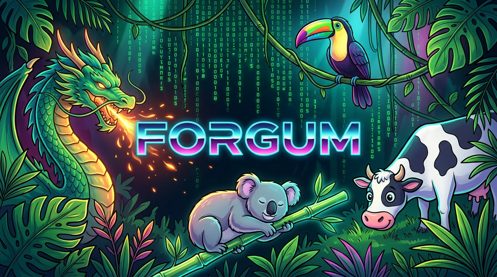

<p align="center">
  
</p>

```text
+--------------------------------------------------------------------------------------------------+
|                              *  ~  *  FORGUM JUNGLE ENGINE  *  ~  *                              |
+==================================================================================================+
|        / \  //\                                                                                  |
| |\___/|/  \//  \\   ███████╗ ██████╗ ██████╗  ██████╗ ██╗   ██╗███╗   ███╗  \   ^__^             |
| /O   O \_ / // | \  ██╔════╝██╔═══██╗██╔══██╗██╔════╝ ██║   ██║████╗ ████║   \  (oo)\_______     |
| \@_^_@'/ \/_// |  \ █████╗  ██║   ██║██████╔╝██║  ███╗██║   ██║██╔████╔██║      (__)\       )\/\ |
|  //_^_/  \///  |  ) ██╔══╝  ██║   ██║██╔══██╗██║   ██║██║   ██║██║╚██╔╝██║          ||----w |    |
|( //) |    //   | /  ██║     ╚██████╔╝██║  ██║╚██████╔╝╚██████╔╝██║ ╚═╝ ██║          ||     ||    |
|                     ╚═╝      ╚═════╝ ╚═╝  ╚═╝ ╚═════╝  ╚═════╝ ╚═╝     ╚═╝                       |
|                * * *  K I N E M A T I C   J U N G L E   M E N A G E R I E  * * *                 |
|                          ___                                     .___.                           |
|                          {~o.o~} ( ( (   A N I M A T E D   ) ) ) {o,o}                           |
|                         ( Y )  ) ) )      P A S T U R E     ( ( ( /)__)                          |
|                          ()~*~() ( ( (      M O T I O N      ) ) )  ""                           |
+==================================================================================================+
|       [Dragon: Ember]          [Koala: Zen]          [Toucan: Sky]         [Cow: Pasture]        |
+--------------------------------------------------------------------------------------------------+
```

> **Forgum** is a high-performance terminal mascot & 2D physics animation engine written in pure, safe Rust.
> The modern successor to **cowsay**, **ponysay**, **lolcat**, and **fortune** — rendering living ANSI creatures
> with stride-velocity coupled kinematics, procedural nature horizons, curated themes, and DECSTBM split-scroll multitasking.
> Cross-platform on Windows, macOS, Linux, and BSD.

<p align="center">
  <a href="https://github.com/HKDevLoops/Forgum/releases"></a>
  <a href="docs/TELEMETRY.md"></a>
  <a href="docs/TELEMETRY.md"></a>
  <a href="docs/TELEMETRY.md"></a>
  <a href="docs/TELEMETRY.md"></a>
  <a href="LICENSE"></a>
</p>

---

## 📑 Table of Contents

1. [✨ The Modern cowsay & lolcat Alternative](#-the-modern-cowsay--lolcat-alternative)
2. [🚀 30-Second Quickstart (Zero Configuration)](#-30-second-quickstart-zero-configuration)
   - [The Forgum Farm in Animal Voices](#-the-forgum-farm-in-animal-voices)
   - [Universal Interactive Options Discovery](#-universal-interactive-options-discovery)
3. [🎪 Visual Highlights & Core Features](#-visual-highlights--core-features)
   - [The 130+ Mascot Menagerie & Coat Morphs](#1-the-130-mascot-menagerie--coat-morphs)
   - [15 Preloaded Curated Themes](#2-15-preloaded-curated-themes)
   - [Procedural Nature Horizons & Biomes](#3-procedural-nature-horizons--biomes)
   - [Terminal Viewport Reservation & DECSTBM Split-Scroll](#4-terminal-viewport-reservation--decstbm-split-scroll)
   - [Image to ASCII & Custom Mascot Converter](#5-image-to-ascii--custom-mascot-converter)
   - [Forgum Configurator Studio (Interactive TUI)](#6-forgum-configurator-studio-interactive-tui)
4. [📦 Installation & Multi-Channel Distribution](#-installation--multi-channel-distribution)
   - [1-Command Quick Install](#1-command-quick-install)
   - [Multi-Channel Package Managers Matrix](#multi-channel-package-managers-matrix)
   - [Cryptographic Verification & SLSA Attestation](#cryptographic-verification--slsa-attestation)
   - [Package Manager Migration & Reconciliation](#package-manager-migration--reconciliation)
   - [Duplicate & Shadow Installation Pruner (`forgum prune`)](#duplicate--shadow-installation-pruner-forgum-prune)
5. [🐚 Shell Integration & Ecosystem](#-shell-integration--ecosystem)
   - [One-Command Prompt Setup](#one-command-prompt-setup)
   - [Universal 15-Shell Reference Table](#universal-15-shell-reference-table)
   - [Universal Shell Completions](#universal-shell-completions)
   - [Awesome-Shell & Terminal Multiplexers](#awesome-shell--terminal-multiplexers)
6. [📊 Complete CLI Command & Argument Reference](#-complete-cli-command--argument-reference)
   - [Subcommands Reference Table](#subcommands-reference-table)
   - [Primary Command Flags Table](#primary-command-flags-table)
   - [Expressions & Mood Modifiers Table](#expressions--mood-modifiers-table)
   - [Color Modes & Palettes Table](#color-modes--palettes-table)
   - [Unified 17-Key Configuration Schema](#unified-17-key-configuration-schema)
7. [🧮 Under The Hood: Kinematics & Nature Mathematics](#-under-the-hood-kinematics--nature-mathematics)
   - [Continuous Newtonian Kinematics & Stride-Velocity Coupling](#1-continuous-newtonian-kinematics--stride-velocity-coupling)
   - [Procedural Mountains & Golden Ratio Peak Scaling](#2-procedural-mountains--golden-ratio-peak-scaling)
   - [Fibonacci Phyllotaxis Flora Placement](#3-fibonacci-phyllotaxis-flora-placement)
   - [Bounding-Hull Silhouette Occlusion Buffer](#4-bounding-hull-silhouette-occlusion-buffer)
   - [Strict Lightweight Memory Ceiling (<100MB RAM Mandate)](#5-strict-lightweight-memory-ceiling-100mb-ram-mandate)
8. [🩺 Maintenance, Diagnostics & Uninstallation](#-maintenance-diagnostics--uninstallation)
   - [Diagnostics with `checkhealth`](#diagnostics-with-checkhealth)
   - [Structured Logging & Triage (`forgum logs`, `forgum diagnose`)](#structured-logging--triage-forgum-logs-forgum-diagnose)
   - [Clean Uninstallation (Soft vs. Purge)](#clean-uninstallation-soft-vs-purge)
9. [📚 Documentation Index & Deep Dives](#-documentation-index--deep-dives)
10. [📜 License & Community Credits](#-license--community-credits)

---

## ✨ The Modern cowsay & lolcat Alternative

> **Keywords:** cowsay alternative · terminal animation · shell animations · ASCII art mascots · lolcat replacement · ponysay alternative · terminal eye candy · ascii animation · fortune quotes · rust cli · ricing · dotfiles · shell prompt · tui · terminal customization

In 1999, `cowsay` brought whimsy to static terminal consoles. For over two decades, it served as a beloved staple in dotfiles, motd scripts, and shell configs. As terminal emulators evolved to support 24-bit TrueColor, Unicode graphemes, and sub-millisecond VT rendering, we asked: **What if terminal mascots could truly live in the terminal—walking, flying, and resting across procedural landscapes while remaining ultra-lightweight and respectful of system resources?**

**Forgum** is the modern, pure-Rust successor to classic CLI toys like **cowsay**, **ponysay**, **lolcat**, **fortune**, **cmatrix**, and **asciiquarium**. Rather than printing static ASCII text into the shell scrollback, Forgum runs an industrial-grade, lock-free 2D physical simulation canvas right above your prompt.

### 🆚 Forgum vs. Classic Terminal Tools

| Feature | **Forgum** 🦁 | cowsay 🐮 | ponysay 🐴 | lolcat 🌈 | fortune 🔮 | cmatrix 🟩 | asciiquarium 🐠 |
|:--------|:------------:|:---------:|:----------:|:---------:|:----------:|:----------:|:---------------:|
| **Language** | Safe Rust | Perl | Python | Ruby / C | C | C | Perl |
| **True Physical Animation** | ✅ Walk, fly, float, swim | ❌ Static | ❌ Static | ❌ N/A | ❌ N/A | ⚠️ Loop only | ⚠️ Loop only |
| **Procedural Nature Scenery** | ✅ Mountains, roads, sky | ❌ | ❌ | ❌ | ❌ | ❌ | ❌ |
| **24-bit TrueColor** | ✅ Continuous HSV wave | ❌ | ❌ | ✅ | ❌ | ⚠️ Basic | ❌ |
| **Particle Physics (Fire, Bubbles, Stars)** | ✅ SplitMix64 PRNG | ❌ | ❌ | ❌ | ❌ | ❌ | ⚠️ Fish only |
| **Fortune Quotes Built-In** | ✅ Pasture catalog | ❌ | ❌ | ❌ | ✅ | ❌ | ❌ |
| **Shell Prompt Integration** | ✅ 15 shells | ❌ | ❌ | ❌ | ❌ | ❌ | ❌ |
| **DECSTBM Split-Scroll Multitasking** | ✅ Non-blocking | ❌ | ❌ | ❌ | ❌ | ❌ | ❌ |
| **Interactive TUI Studio** | ✅ Modeless Tailwind | ❌ | ❌ | ❌ | ❌ | ❌ | ❌ |
| **Cross-Platform Support** | ✅ Win / Mac / Linux / BSD | ❌ Fork needed | ❌ | ⚠️ | ✅ | ❌ | ❌ |
| **Memory Footprint** | **< 14 MB RAM** | < 1 MB | < 50 MB | < 5 MB | < 1 MB | < 5 MB | < 5 MB |
| **Binary Footprint** | ✅ Zero-dependency single binary | ❌ Needs Perl | ❌ Needs Python | ❌ Ruby runtime | ❌ C runtime | ❌ Needs ncurses | ❌ Needs CPAN |
| **Stride-Velocity Coupling** | ✅ True kinematic gait | ❌ | ❌ | ❌ | ❌ | ❌ | ❌ |
| **Mascot Catalog** | **130+ animals** | ~50 cows | ~400 ponies | — | — | — | ~10 aquatic |
| **Package Managers** | 15 channels (Winget, Scoop, Brew, Pacman, APT, DNF...) | apt / brew | apt / brew | apt / brew | apt / brew | apt | cpan |

---

## 🚀 30-Second Quickstart (Zero Configuration)

Forgum requires **zero configuration files** to get started. Open your terminal and run:

```bash
# 1. Run the living pasture with a random fortune and animated mascot:
forgum

# 2. Ponder a thought over procedural alpine mountains and walking kinematics:
forgum think "The terminal is my canvas." --mountain alpine --road trail --effect walk

# 3. Speak your mind with classic speech borders and custom eyes:
forgum say -c tux -e '$$' -t 'U' "Hello from the modern terminal!"
```

By default, **random thoughts are enabled**. Whenever you invoke `forgum` without explicit text, the engine loads an authentic quote from its pasture fortune library and wraps it inside a thought bubble `( ... )` with `o` connector rings.

### 🎪 The Forgum Farm in Animal Voices

Every Forgum scene is governed by a `SceneConfig`. Think of your scene as a pasture, and each parameter as one of the friendly animals that lives there:

* 🐮 **The Cow says:** *"Moo! I am the mascot — set `cow` to pick from 130+ creatures (`dragon`, `tux`, `koala`, `nyan`, `elephant`), or set `cow: "random"` to meet someone new every execution."*
* 💭 **The Thought says:** *"Whenever you run `forgum` or `forgum think`, I wrap witty fortune cookies in round `( ... )` bubbles with `o` connector circles."*
* 💬 **The Speech says:** *"When you pass explicit text with `forgum say`, I carry your words inside crisp `| ... |` borders with directional `\` stems."*
* ✨ **The Effect says:** *"I drive the physical animation algorithm — `walk` strides, `fly` swoops, `float` Lissajous drift, `breathe` chest oscillations, and `ember` fire sparks."*
* 🏔️ **The Mountain says:** *"I generate deterministic alpine crests, flat mesas, and volcanic calderas using harmonic sinusoidal superposition."*
* 🦎 **The Chameleon says:** *"I ensure colors look gorgeous on every terminal — automatically negotiating between 24-bit TrueColor, 256-color, 16-color, and monochrome."*

### 🔍 Universal Interactive Options Discovery

Curious about what mascots, mountain styles, or environments are available? Discover every parameter directly from your terminal:

```bash
# Display the interactive Unicode discovery table:
forgum list

# Inspect candidate options for any specific argument on the fly:
forgum --animal list
forgum --effect list
forgum --mountain list
forgum --road list
forgum --env list
forgum --color-mode list
forgum --palette list
forgum --eyes list
forgum --tongue list
```

---

## 🎪 Visual Highlights & Core Features

### 1. The 130+ Mascot Menagerie & Coat Morphs

Forgum ships with **130+ built-in ASCII creatures** categorized by habitat and biological taxonomy:
* **Classic Bovines**: `default`, `cow`, `cowsay`, `small`, `eyes`, `bud-frogs`, `three-eyes`, `flaming-cow`
* **Mythical & Fantasy**: `dragon`, `dragon-and-cow`, `daemon`, `ghost`, `skeleton`, `vampire`, `cthulhu`, `unicorn`
* **Wild Mammals**: `elephant`, `moose`, `koala`, `bear`, `fox`, `wolf`, `lion`, `tiger`, `kangaroo`, `hippo`
* **Aquatic & Oceanic**: `dolphin`, `happy-whale`, `shark`, `octopus`, `squid`, `duck`, `frog`, `seahorse`, `turtle`
* **Aerial Birds**: `golden-eagle`, `owl`, `toucan`, `turkey`, `rooster`, `pterodactyl`
* **Cybernetic & Pop**: `mech-and-cow`, `telebears`, `nyan`, `tardis`, `bender`, `homer`, `vader`, `mario`, `sonic`
* **OS & Tech Companions**: `tux` (Linux), `gnu` (GNU), `bsd-daemon` (FreeBSD), `rust-ferris` (Rust), `gopher` (Go)

> 📖 **Coat Polymorphism**: In `natural` color mode, animals express authentic biological phenotypes (e.g. Cattle: Holstein, Charolais, Black Angus; Tiger: Bengal, White Bengal; Koala: wild grey). See [`docs/HERD.md`](docs/HERD.md).

### 2. 15 Preloaded Curated Themes

Themes combine mascot, effect, scenery, eyes, and color palettes into cohesive visual presets:

```bash
# List all built-in themes:
forgum theme list

# Apply a curated theme immediately:
forgum theme apply matrix
forgum theme apply cyberpunk
forgum theme apply inferno
forgum theme apply zen

# Rotate themes periodically every N minutes:
forgum theme rotate --interval 10
```

| Theme | Animation Effect | Cow Mascot | Eyes | Aesthetic |
| :--- | :--- | :--- | :--- | :--- |
| `arcade` | `walk` | `default` | `oo` | Retro 8-bit pasture walk |
| `aurora` | `aurora` | `default` | `oo` | Northern lights shifting colors |
| `cyberpunk` | `glitch` | `mech-and-cow` | `$$` | Neo-Tokyo neon scanline distortion |
| `forest` | `breathe` | `koala` | `..` | Gentle bamboo forest chest respiration |
| `ghost` | `portal` | `ghost` | `xx` | Ethereal spectral portal phasing |
| `inferno` | `ember` | `dragon` | `@@` | Blazing fire particles & smoke |
| `matrix` | `glitch` | `telebears` | `00` | Cascading phosphor green rain |
| `nyan` | `float` | `nyan` | `^^` | 2D cosmic rainbow orbital drift |
| `ocean` | `float` | `dolphin` | `oo` | Underwater buoyancy drift & bubbles |
| `retro` | `walk` | `default` | `oo` | Classical terminal stride |
| `zen` | `breathe` | `tux` | `==` | Meditative penguin stillness |

### 3. Procedural Nature Horizons & Biomes

Forgum generates dynamic natural backdrops using continuous harmonic mathematical synthesis:
* **Mountains (`--mountain`)**: `smooth`, `jagged`, `peaks`, `alpine`, `dunes`, `plateau`, `mesa`, `volcanic`, `sierra`, `ridge`
* **Roads & Trails (`--road`)**: `highway`, `trail`, `cobblestone`, `neon`, `dirt`, `gravel`, `railway`, `stream`, `path`, `cyber`, `sand`, `grass`
* **Biomes (`--env`)**: `pasture`, `sunset`, `cyberpunk`, `matrix`, `vaporwave`, `midnight`, `autumn`, `desert`, `arctic`, `volcano`, `deepsea`

### 4. Terminal Viewport Reservation & DECSTBM Split-Scroll

Run rich physical animations overhead without interfering with your shell commands! Using ANSI DEC Set Top and Bottom Margins (`\x1b[top;bottomr`):
* **Top Header Rows ($1 \dots K$)**: Locked for continuous 30/60 FPS animation (mascots, mountains, trees).
* **Workspace Rows ($(K+1) \dots N$)**: The shell scrolls and outputs commands (`git`, `cargo`, `ls`, `vim`) freely underneath without cursor jitter or visual crosstalk.

```bash
# Reserve top 10 rows for non-blocking background animation:
forgum render --split-scroll --reserve-rows 10 --background
```

### 5. Image to ASCII & Custom Mascot Converter

Built-in zero-dependency image-to-ASCII converter (`forgum image`) featuring ITU-R BT.601 luminance weighting and 1:2 font aspect ratio cell correction:

```bash
# Convert image into high-resolution TrueColor ASCII art:
forgum image photo.png --width 50

# Convert image into a reusable .cow file with automated speech anchors:
forgum image avatar.png --save-cow mycritter --width 40

# Render scene directly using an image mascot:
forgum render --image ./logo.png --text "Living image mascot!"
```

### 6. Forgum Configurator Studio (Interactive TUI)

Launch the full-screen terminal configuration studio with **Tailwind CSS-inspired design tokens** (Slate-800 dark pills, Indigo/Emerald accents, rounded borders):

```bash
forgum tui
# or
forgum config --tui
```

* **Modeless Direct Navigation**: Navigate freely with `h`/`j`/`k`/`l`, `gg`, `G`, `Ctrl+d`, `Ctrl+u`, `gt`, `gT`.
* **100% Config & Scripting Parity**: Inspect, toggle, or step all 26 engine settings directly.
* **External Editor Keybinding (`o` / `Ctrl+O`)**: Press `o` to suspend raw mode and open the config file in your preferred editor (`nvim`, `vim`, `nano`, `code`).

---

## 📦 Installation & Multi-Channel Distribution

Forgum is distributed across 15+ channels with native binaries for Windows, macOS, Linux, and BSD.

### 1-Command Quick Install

#### Windows (PowerShell 5.1 / PowerShell 7+):
```powershell
irm https://raw.githubusercontent.com/HKDevLoops/Forgum/dev/install.ps1 | iex
```

#### macOS, Linux & BSD (Bash / Zsh / Fish):
```bash
curl -4 -fsSL --connect-timeout 5 https://raw.githubusercontent.com/HKDevLoops/Forgum/dev/install.sh | bash
```

#### 🛡 Headless & Offline Install:
Prefer zero interactive UI and zero telemetry? Install headlessly with telemetry declined:
```powershell
./install.ps1 -Headless -Telemetry decline
```
```bash
./install.sh --headless --telemetry decline
```

### Multi-Channel Package Managers Matrix

| OS / Ecosystem | Package Manager | Installation Command | Update Command |
| :--- | :--- | :--- | :--- |
| **Windows** | **Scoop** | `scoop bucket add hkdevloops https://github.com/HKDevLoops/scoop-bucket; scoop install forgum` | `scoop update forgum` |
| **Windows** | **WinGet** | `winget install HKDevLoops.Forgum` | `winget upgrade HKDevLoops.Forgum` |
| **Windows** | **Chocolatey** | `choco install forgum -y` | `choco upgrade forgum -y` |
| **macOS & Linux** | **Homebrew** | `brew install hkdevloops/tap/forgum` | `brew upgrade forgum` |
| **Arch Linux** | **AUR (yay / paru)** | `yay -S forgum` or `paru -S forgum` | `yay -Syu` |
| **Debian / Ubuntu**| **APT / dpkg** | `sudo dpkg -i forgum-*.deb` | `sudo apt install --only-upgrade forgum` |
| **Fedora / RHEL** | **DNF / RPM** | `sudo rpm -ivh forgum-*.rpm` | `sudo dnf upgrade forgum` |
| **openSUSE** | **Zypper** | `sudo zypper install forgum-*.rpm` | `sudo zypper update forgum` |
| **Nix / NixOS** | **Nix Profile** | `nix profile install github:HKDevLoops/Forgum` | `nix profile upgrade forgum` |
| **Alpine Linux** | **APK** | `apk add forgum` | `apk upgrade forgum` |
| **Void Linux** | **XBPS** | `xbps-install -S forgum` | `xbps-install -Su forgum` |
| **FreeBSD** | **pkg** | `pkg install forgum` | `pkg upgrade forgum` |
| **Universal** | **Cargo (Rust)** | `cargo install --path crates/engine --bin forgum` | `cargo install --force --path crates/engine --bin forgum` |

> 📖 For detailed instructions, offline options, and package verification, see [`docs/INSTALLATION.md`](docs/INSTALLATION.md).

### Cryptographic Verification & SLSA Attestation

Every release publishes an authoritative `SHA256SUMS` manifest alongside Sigstore SLSA build provenance:
```bash
# Linux / macOS / BSD:
sha256sum -c forgum-*.tar.gz.sha256

# Windows PowerShell:
(Get-FileHash .\forgum-*-windows-x64.zip -Algorithm SHA256).Hash -eq (Get-Content .\forgum-*-windows-x64.zip.sha256).Split(" ")[0]

# Verify Sigstore provenance attestation with GitHub CLI:
gh attestation verify forgum --owner HKDevLoops
```

### Package Manager Migration & Reconciliation

Switched from standalone script to Scoop, Brew, or WinGet? Reconcile automatically:
```bash
forgum update --method scoop      # Windows Scoop
forgum update --method winget     # Windows WinGet
forgum update --method brew       # macOS / Linux Homebrew
forgum update --method yay        # Arch Linux AUR
```

### Duplicate & Shadow Installation Pruner (`forgum prune`)

Detect and remove duplicate binaries across your system `$PATH`:
```bash
# Dry run preview:
forgum prune --dry-run

# Interactively remove shadowed binaries:
forgum prune

# Automated script cleanup:
forgum prune --yes
```

---

## 🐚 Shell Integration & Ecosystem

### One-Command Prompt Setup

Automatically inject isolated prompt hooks into your active shell:
```bash
forgum init --install
# Or specify explicitly:
forgum init <shell> --install
```

All shell hooks maintain strict marker isolation (`# >>> forgum >>>` ... `# <<< forgum <<<`) with zero shell startup latency.

### Universal 15-Shell Reference Table

| Shell | Automated Hook Injection | Tab Completion Setup | Target Profile Path |
| :--- | :--- | :--- | :--- |
| **PowerShell 7+ (`pwsh`)** | `forgum init pwsh --install` | `forgum completions pwsh \| Out-File $PROFILE` | `$PROFILE` |
| **Windows PowerShell 5.1** | `forgum init powershell --install` | `forgum completions powershell \| Out-File $PROFILE` | `$PROFILE` |
| **Bash** | `forgum init bash --install` | `forgum completions bash > ~/.bash_completion` | `~/.bashrc` |
| **Zsh** | `forgum init zsh --install` | `forgum completions zsh > ~/.zsh/completions/_forgum`| `~/.zshrc` |
| **Fish** | `forgum init fish --install` | `forgum completions fish > ~/.config/fish/completions/forgum.fish` | `~/.config/fish/config.fish` |
| **Nushell** | `forgum init nushell --install` | `forgum completions nu > ~/.config/nushell/completions/forgum.nu` | `~/.config/nushell/config.nu` |
| **Elvish** | `forgum init elvish --install` | `forgum completions elvish > ~/.config/elvish/lib/forgum.elv` | `~/.config/elvish/rc.elv` |
| **Cmd (`cmd.exe`)** | `forgum init cmd --install` | *(doskey alias helper)* | Registry `AutoRun` / `AutoRun.cmd` |
| **Carapace** | `forgum init carapace --install`| `forgum completions carapace` | `~/.config/carapace/specs/forgum.yaml` |
| **Xonsh** | `forgum init xonsh --install` | `forgum completions xonsh > ~/.xonshrc` | `~/.xonshrc` |
| **Tcsh (`csh`)** | `forgum init tcsh --install` | `forgum completions tcsh > ~/.cshrc` | `~/.cshrc` |
| **Ksh (`ksh93/mksh`)** | `forgum init ksh --install` | `forgum completions ksh > ~/.kshrc` | `~/.kshrc` |
| **Ion** | `forgum init ion --install` | `forgum completions ion > ~/.config/ion/initrc` | `~/.config/ion/initrc` |
| **Oil (`osh/ysh`)** | `forgum init oil --install` | `forgum completions oil > ~/.config/oil/yshrc` | `~/.config/oil/yshrc` |
| **Yash** | `forgum init yash --install` | `forgum completions yash > ~/.yashrc` | `~/.yashrc` |

> 📖 For comprehensive hook details and edge cases, see [`docs/SHELL-INTEGRATION.md`](docs/SHELL-INTEGRATION.md).

### Universal Shell Completions

```bash
# Launch interactive completion updater across detected shells:
forgum completions update

# Check freshness of installed completions:
forgum completions check
```

### Awesome-Shell & Terminal Multiplexers

| Tool | Integration Command | Capability |
| :--- | :--- | :--- |
| **tmux** | `forgum tmux install >> ~/.tmux.conf` | Zero-flicker DCS pass-through status updates |
| **zellij** | `forgum tmux zellij` | Native plugin pane rendering |
| **wezterm** | `forgum tmux wezterm` | Lua status line generator and GPU shader sync |
| **starship**| `forgum init starship` | Custom prompt module emitting ANSI mascots |
| **fzf** | `forgum list animals \| fzf --preview 'forgum -c {} --text "Preview"'` | Interactive mascot selector |
| **bat** | `forgum --text-only \| bat` | Color-aware pager formatting |

---

## 📊 Complete CLI Command & Argument Reference

### Subcommands Reference Table

| Subcommand | Aliases | Parameters / Syntax | Description | Example |
| :--- | :--- | :--- | :--- | :--- |
| **`render`** | *(default)* | `[OPTIONS] [TEXT]...` | Renders animated scenes with scenery & kinematics | `forgum render -E walk -c dragon` |
| **`think`** | `ponder` | `[OPTIONS] [TEXT]...` | Thought bubble `( ... )` with `o` connector rings | `forgum think "Deep thoughts"` |
| **`say`** | `speak` | `[OPTIONS] [TEXT]...` | Speech bubble with diagonal `\` stems | `forgum say "Hello World"` |
| **`fortune`** | `quote` | *(none)* | Prints a random quote from the pasture catalog | `forgum fortune` |
| **`tui`** | `studio` | `[TAB]` | Fullscreen interactive configuration studio | `forgum tui` |
| **`install`** | `wizard` | `[--headless] [--telemetry <CONSENT>]` | Interactive setup wizard and shell installer | `forgum install` |
| **`uninstall`**| `remove` | `[-m soft\|purge] [-y] [--tui]` | Cleanly uninstalls Forgum (Soft or Purge) | `forgum uninstall --method soft` |
| **`update`** | `upgrade` | `[--check]` | Checks for updates or upgrades Forgum | `forgum update` |
| **`list`** | `ls`, `show` | `[CATEGORY]` | Displays responsive Unicode options discovery table | `forgum list all` |
| **`completions`**| `complete`| `[SHELL]` | Emits or auto-installs syntax autocompletion scripts | `forgum completions update` |
| **`init`** | `hook` | `[SHELL] [--install]` | Injects shell prompt integration hooks | `forgum init zsh --install` |
| **`config`** | `cfg` | `[KEY] [VALUE] [--tui] [--migrate <FMT>]`| Reads, writes, or migrates configuration | `forgum config set cow tux` |
| **`theme`** | `themes` | `[list \| apply <NAME> \| rotate [MINS]]`| Manages 15 built-in and user themes | `forgum theme apply matrix` |
| **`checkhealth`**| `doctor`| `[--json]` | Runs 12 diagnostic probes across system & terminals | `forgum checkhealth` |
| **`logs`** | `log` | `[-f] [-l <LEVEL>] [-o]` | Inspects structured logs or opens in editor | `forgum logs -l warn` |
| **`diagnose`** | `triage` | `[-n <LINES>] [--json]` | Automated diagnostic triage engine | `forgum diagnose` |
| **`battle`** | `arena` | `[FIGHTER1] [FIGHTER2]` | Turn-based ASCII battle simulation between mascots | `forgum battle "Alice" "Bob"` |
| **`rps-battle`**| `rps` | `[--player <NAME>] [-c <WEAPON>]` | Interactive Rock-Paper-Scissors mascot clash | `forgum rps-battle` |
| **`image`** | *(none)* | `<PATH> [-w <WIDTH>] [--save-cow]` | Converts image to TrueColor ASCII or `.cow` mascot | `forgum image avatar.png` |
| **`timer`** | `stopwatch`| `<DURATION> [COMMAND]...` | Animated countdown timer and command benchmark | `forgum timer 10s cargo build` |
| **`status-line`**| *(none)*| `[--max-len <LEN>]` | Single-line compact ANSI status reporter for tmux | `forgum status-line --max-len 80`|
| **`sweep`** | `clean` | *(none)* | Emergency recovery command to restore terminal state | `forgum sweep` |

### Primary Command Flags Table

| Flag | Short | Type | Default | Description | Discovery |
| :--- | :--- | :--- | :--- | :--- | :--- |
| `--animal`, `--cow` | `-c` | `String` | `"default"` | Mascot character template from 130+ creatures | `--animal list` |
| `--effect`, `--animation` | `-E`, `-a`| `String` | `"walk"` | Kinematic motion algorithm (`walk`, `fly`, `float`, `breathe`, `ember`, `glitch`...) | `--effect list` |
| `--mountain` | *(none)* | `String` | `"smooth"` | Procedural mountain backdrop style | `--mountain list` |
| `--road` | *(none)* | `String` | `"highway"` | Ground terrain and road surface style | `--road list` |
| `--env`, `--environment`| *(none)* | `String` | `"pasture"` | Biome preset (sky, lighting, ambient particles) | `--env list` |
| `--color-mode` | `-C` | `String` | `"truecolor"` | Color depth mode (`truecolor`, `256`, `16`, `mono`) | `--color-mode list` |
| `--palette` | `-p` | `String` | `"rainbow"` | Color gradient palette for lolcat dispersion | `--palette list` |
| `--eyes` | `-e` | `String` | `"oo"` | Facial expression eyes override | `--eyes list` |
| `--tongue` | `-T` | `String` | `"  "` | Facial expression tongue override | `--tongue list` |
| `--duration` | `-d` | `u64` | `0` (or `3` fg)| Playback duration in seconds (`0` = infinite) | `--duration 5` |
| `--fps` | `-f` | `u32` | `60` | Target animation frames per second (1–120) | `--fps 30` |
| `--text` | *(none)* | `String` | Random Fortune | Explicit speech/thought text | `--text "Hello"` |
| `--think` | *(none)* | `bool` | `true` (if empty)| Enforces thought bubble `( ... )` formatting | `--think` |
| `--split-scroll` | *(none)* | `bool` | `false` | Locks top margin via DECSTBM for multitasking | `--split-scroll` |
| `--background` | `-b` | `bool` | `false` | Renders non-blocking overlay above prompt | `--background` |
| `--accel` | *(none)* | `String` | `"auto"` | Compute acceleration (`auto`, `dedicated`, `integrated`, `cpu`)| `--accel dedicated`|
| `--aspect` | *(none)* | `String` | `"auto"` | Viewport aspect ratio preset (`21:9`, `16:9`, `16:10`, `4:3`)| `--aspect 16:9` |

### Expressions & Mood Modifiers Table

| Feature | CLI Flag | Value | Mood Expression | Rendering Sample |
| :--- | :--- | :--- | :--- | :--- |
| **Eyes** | `-e oo` | `oo` | Attentive / Normal | Open rounded eyes `(oo)` |
| **Eyes** | `-e $$` | `$$` | Greedy / Cyber | Dollar sign oculars `($$)` |
| **Eyes** | `-e @@` | `@@` | Hypnotized / Stoned | Spiral concentric eyes `(@@)` |
| **Eyes** | `-e xx` | `xx` | Knocked Out / Dead | Criss-cross X eyes `(xx)` |
| **Eyes** | `-e ==` | `==` | Zen / Meditative | Closed horizontal slits `(==)` |
| **Eyes** | `-e ^^` | `^^` | Happy / Joyful | Cheerful anime upturned eyes `(^^)` |
| **Eyes** | `-e **` | `**` | Dazed / Starstruck | Sparkling asterisk eyes `(**)` |
| **Eyes** | `-e ..` | `..` | Sleepy / Subtle | Minimalist dot eyes `(..)` |
| **Eyes** | `-e 00` | `00` | Robotic / LED | Glowing LED oculars `(00)` |
| **Tongue**| `-T "U "` | `U ` | Blep / Playful | Classic pink bovine tongue `( U )` |
| **Tongue**| `-T "V "` | `V ` | Forked / Reptilian | Forked snake/dragon tongue `( V )` |
| **Tongue**| `-T "w "` | `w ` | Cute / Anime | W-shaped feline muzzle curl `( w )` |
| **Tongue**| `-T "  "` | `"  "` | Retracted / None | Closed clean muzzle without tongue |

### Color Modes & Palettes Table

| Color Mode | Flag | Bit Depth | Escape Sequences | Best For |
| :--- | :--- | :--- | :--- | :--- |
| **TrueColor** | `-C truecolor` | 24-bit direct | `\x1b[38;2;R;G;Bm` | Windows Terminal, Ghostty, WezTerm, Alacritty, Kitty |
| **256-Color** | `-C 256` | 8-bit indexed | `\x1b[38;5;Nm` | xterm-256color, tmux internal windows, macOS Terminal.app |
| **16-Color** | `-C 16` | 4-bit standard | `\x1b[30m` – `\x1b[37m` | Linux VT consoles (`/dev/tty1`), legacy SSH terminals |
| **Monochrome** | `-C mono` | 1-bit text | None (pure ASCII) | Braille displays, screen readers, automated pipelines |

### Unified 17-Key Configuration Schema

| Config Key | Data Type | Default | CLI Mapping | Description |
| :--- | :--- | :--- | :--- | :--- |
| `cow` | `String` | `"default"` | `--animal`, `-c` | Selected mascot character template |
| `effect` | `String` | `"walk"` | `--effect`, `-E` | Primary animation algorithm |
| `mountain` | `String` | `"smooth"` | `--mountain` | Procedural mountain style |
| `road` | `String` | `"highway"` | `--road` | Terrain and road rendering style |
| `environment` | `String` | `"pasture"` | `--env` | Biome, sky gradient, and atmospheric particles |
| `color_mode` | `String` | `"truecolor"` | `--color-mode`, `-C` | Color depth rendering mode |
| `palette` | `String` | `"rainbow"` | `--palette`, `-p` | Color gradient palette for lolcat cycle |
| `eyes` | `String` | `"oo"` | `--eyes`, `-e` | Facial expression eye characters |
| `tongue` | `String` | `"  "` | `--tongue`, `-T` | Facial expression tongue characters |
| `fps` | `u32` | `60` | `--fps`, `-f` | Frame rate (1–120 FPS) |
| `duration` | `u64` | `0` (or `3` fg) | `--duration`, `-d` | Playback duration in seconds (`0` = infinite) |
| `thought_interval`| `u64` | `60` | `--thought-interval` | Rotation interval for random fortune cookies |
| `split_scroll` | `bool` | `false` | `--split-scroll` | Restrict scrolling region via DECSTBM |
| `background` | `bool` | `false` | `--background`, `-b` | Render in non-blocking background overlay |
| `auto_render_on_prompt`| `bool` | `true` | `init` setting | Trigger automatic render on new prompt |
| `default_shell` | `String` | Auto-detected | `init <SHELL>` | Default shell assumed for hook generation |
| `shell_attach_mode`| `String` | `"banner"` | `--banner` | How the pasture renders relative to the prompt |

> 📖 For advanced config schema keys and migrations (JSON, YAML, TOML), see [`docs/CONFIGURATION.md`](docs/CONFIGURATION.md).

---

## 🧮 Under The Hood: Kinematics & Nature Mathematics

Forgum treats your terminal as a discrete 2D physics simulation canvas rather than a static text dumper.

### 1. Continuous Newtonian Kinematics & Stride-Velocity Coupling

Entities track continuous floating-point coordinates integrated with sub-millisecond precision:
$$\vec{P}(t + \Delta t) = \vec{P}(t) + \vec{V}(t)\Delta t + \frac{1}{2}\vec{A}(t)\Delta t^2$$

To prevent the "moonwalk bug" (where leg characters cycle without moving forward), leg cadence is mathematically coupled to ground velocity:
$$\omega_{\text{stride}} = \frac{v_{\text{walk}}}{\lambda_{\text{step}}}, \quad \phi_{\text{stride}}(t) = \left( \frac{|P_x(t)|}{\lambda_{\text{step}}} \right) \pmod{1.0}$$
During stance phase, contact velocity $\vec{v}_{\text{contact}} = 0$. When the creature stops, leg cycling ceases instantly.

### 2. Procedural Mountains & Golden Ratio Peak Scaling

Mountain horizons are generated per column $x$ using continuous multi-harmonic sinusoidal superposition:
$$H(x) = H_{\text{base}} \cdot \left[ 1 + \sum_{k=1}^{K} A_k \cdot \left| \sin\left( \frac{2\pi k}{\lambda} x + \phi_k \right) \right|^\gamma \right]$$

Peak count $N_{\text{peaks}}$ scales mathematically with viewport width $W$ and the Golden Ratio ($\Phi \approx 1.6180339887$):
$$N_{\text{peaks}} = \mathrm{clamp}\left(\left\lfloor \frac{W}{\lambda \cdot (\Phi / 2)} \right\rceil, 1, 12\right)$$
* **Alpine Crests (`alpine`, `peaks`)**: Power-pinched exponent $\gamma = 1.85$ sculpts sharp needles separated by broad glacial cirques.
* **Mesas & Tablelands (`plateau`)**: Hyperbolic tangent cliff saturation $H(x) \propto \tanh(3 \sin(\omega x))$.
* **Volcanic Cones (`volcano`)**: Continuous Lorentzian cone $\frac{A}{1 + (x/\sigma)^2}$ with an inverted central caldera.

### 3. Fibonacci Phyllotaxis Flora Placement

Midground trees and flora are spaced using Golden Ratio phyllotaxis dispersion ($\Phi^{-1} \approx 0.61803398875$):
$$d(k) = \max\left(0.7 \cdot d_{\min}, \; d_{\min} + \{k \cdot \Phi^{-1}\} \cdot d_{\text{var}} + \frac{d_{\text{var}}}{4} \cos\left(2\pi \{k \cdot \Phi^{-2}\}\right)\right)$$

Canopy height $H_{\text{tree}}$ scales dynamically to mascot height $H_{\text{animal}}$ ($M=1.25$ for walking animals, $M=0.80$ for flying creatures).

### 4. Bounding-Hull Silhouette Occlusion Buffer

To prevent background scenery from bleeding through ASCII mascots, the compositor evaluates scanline bounding hulls:
$$\Omega_{\text{hull}}(y) = \left[ \min \{x \mid \text{Glyph}(x, y) \neq \text{' '}\}, \; \max \{x \mid \text{Glyph}(x, y) \neq \text{' '}\} \right]$$
Cells within the hull lacking mascot artwork are committed to the depth buffer as opaque spaces, preserving solid visual forms over scrolling backgrounds.

### 5. Strict Lightweight Memory Ceiling (<100MB RAM Mandate)

* Zero per-frame heap allocations in hot render loops.
* Framebuffers are pre-allocated on initialization or terminal resize.
* Under heavy load testing (8 concurrent simulation threads pushing 200 frames each), resident RAM measures **~13.06 MB**, well under the **100 MB** mandate.

---

## 🩺 Maintenance, Diagnostics & Uninstallation

### Diagnostics with `checkhealth`

Modeled after Neovim's `:checkhealth`, `forgum checkhealth` inspects 12 diagnostic probes across 7 core systems:
```bash
forgum checkhealth

# Machine-readable JSON for CI/CD:
forgum checkhealth --json
```

### Structured Logging & Triage (`forgum logs`, `forgum diagnose`)

```bash
# View recent events in formatted table:
forgum logs

# Filter by severity:
forgum logs --level warn

# Real-time tailing:
forgum logs -f

# Run automated diagnostic triage:
forgum diagnose
```

### Clean Uninstallation (Soft vs. Purge)

Forgum guarantees absolute respect for your machine with two distinct uninstallation modes:

```bash
# Method 1: Soft Uninstall (Removes binary & hooks, PRESERVES ~/.config/forgum/):
forgum uninstall --method soft

# Method 2: Purge Uninstall (Completely wipes binary, hooks, configs, cache, logs):
forgum uninstall --method purge --yes

# Interactive Celestial De-Orbit Wizard:
forgum uninstall --tui
```

---

## 📚 Documentation Index & Deep Dives

| Document | Purpose & Contents |
| :--- | :--- |
| [`docs/GUIDE.md`](docs/GUIDE.md) | Comprehensive CLI reference manual, subcommands, and flags |
| [`docs/INSTALLATION.md`](docs/INSTALLATION.md) | Full installation guides across all 15 package managers and OS targets |
| [`docs/CONFIGURATION.md`](docs/CONFIGURATION.md) | In-depth configuration guide, formats (JSON/YAML/TOML), schema keys |
| [`docs/SHELL-INTEGRATION.md`](docs/SHELL-INTEGRATION.md)| Detailed shell hooks, startup integrations, and completion scripts |
| [`docs/CHANNELS.md`](docs/CHANNELS.md) | Release channels (stable, alpha, nightly, dev) and migration guides |
| [`docs/HERD.md`](docs/HERD.md) | Complete animal catalog, biological coat morphs, and DNA profiles |
| [`docs/WSL-GUIDE.md`](docs/WSL-GUIDE.md) | Windows Subsystem for Linux tips, display setup, and interop rules |
| [`docs/FAQ.md`](docs/FAQ.md) | Frequently asked questions, performance tuning, and troubleshooting |
| [`docs/TELEMETRY.md`](docs/TELEMETRY.md) | Transparent motivation telemetry policy (zero personal data, 100% private)|
| [`docs/RELEASE_AND_UPGRADE_AUDIT_MAP.md`](docs/RELEASE_AND_UPGRADE_AUDIT_MAP.md)| Core release engineering protocol and version parity checklist |
| [`docs/audit/`](docs/audit/) | Version-controlled audit reports and release completion certificates |

---

## 📜 License & Community Credits

Forgum is free, open-source software licensed under the **[MIT License](LICENSE)**.

```
    \   ^__^
     \  (oo)\_______
        (__)\       )\/\
            ||----w |
            ||     ||
```

*Crafted with ❤️ and safe Rust by [harish2222](https://github.com/harish2222) (HKDevLoops) · For the terminal cow in all of us.*
