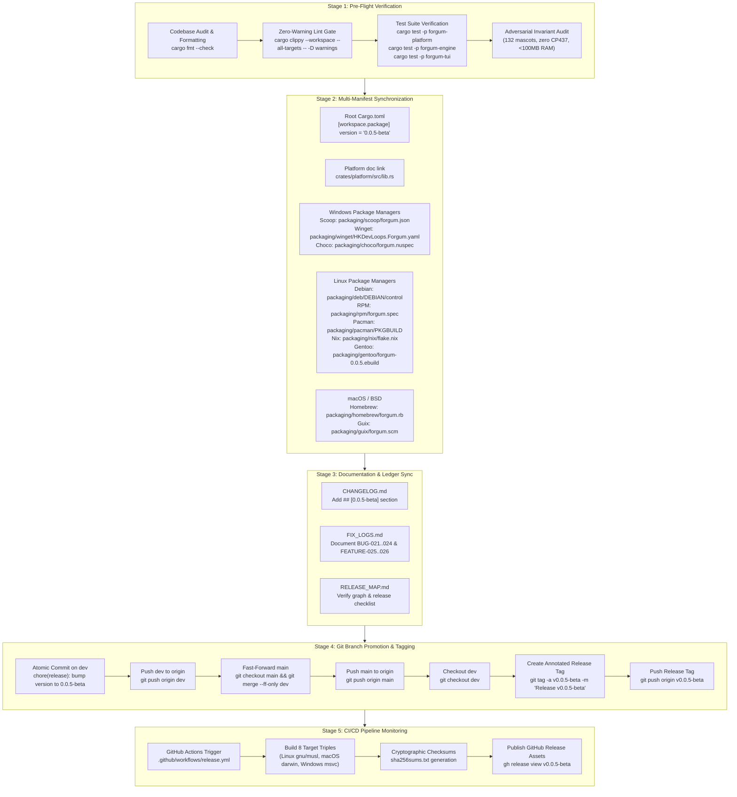

# Forgum Universal Release & Distribution Map (RELEASE_MAP.md)

This document provides the definitive topological graph and execution matrix for releasing Forgum versions. It maps out **what to do**, **how to do it**, **where changes occur**, and **what new capabilities are introduced**.

---

## 1. Release Architecture & Pipeline Flowchart



---

## 2. Release Manifest & File Change Matrix

| Component / Channel | File Path | Field / Variable | Old Value (`0.0.4-beta`) | New Value (`0.0.5-beta`) |
| :--- | :--- | :--- | :--- | :--- |
| **Cargo Workspace** | `Cargo.toml` | `[workspace.package].version` | `"0.0.4-beta"` | `"0.0.5-beta"` |
| **Platform Docs** | `crates/platform/src/lib.rs` | `#![doc(html_root_url = ...)]` | `.../0.0.3-beta` | `.../0.0.5-beta` |
| **Scoop** | `packaging/scoop/forgum.json` | `"version"` & download URLs | `"0.0.4-beta"` | `"0.0.5-beta"` |
| **Winget** | `packaging/winget/HKDevLoops.Forgum.yaml` | `PackageVersion` & URLs | `0.0.4-beta` | `0.0.5-beta` |
| **Chocolatey** | `packaging/choco/forgum.nuspec` | `<version>` | `0.0.4-beta` | `0.0.5-beta` |
| **Homebrew** | `packaging/homebrew/forgum.rb` | `version` | `"0.0.4-beta"` | `"0.0.5-beta"` |
| **Debian (APT)** | `packaging/deb/DEBIAN/control` | `Version:` | `0.0.4-beta` | `0.0.5-beta` |
| **Red Hat (RPM)** | `packaging/rpm/forgum.spec` | `Version:` | `0.0.4` | `0.0.5` |
| **Arch Linux** | `packaging/pacman/PKGBUILD` | `pkgver` | `0.0.4.beta` | `0.0.5.beta` |
| **Nix Flake** | `packaging/nix/flake.nix` | `version = ...` | `"0.0.4-beta"` | `"0.0.5-beta"` |
| **Nix Package** | `packaging/nix/package.nix` | `version = ...` | `"0.0.4-beta"` | `"0.0.5-beta"` |
| **Windows MSI (WiX)** | `packaging/windows/forgum.wxs` | `Version="..."` | `0.0.4` | `0.0.5` |
| **Gentoo** | `packaging/gentoo/forgum-0.0.5.ebuild` | Ebuild filename | `forgum-0.0.4.ebuild` | `forgum-0.0.5.ebuild` |
| **Changelog** | `CHANGELOG.md` | Release header & release date | `## [0.0.4-beta]` | `## [0.0.5-beta] - 2026-10-12` |
| **Defect Ledger** | `FIX_LOGS.md` | Remediation entries | Up to BUG-023 | BUG-021 through FEATURE-026 |

---

## 3. What New Capabilities Are Bundled in `0.0.5-beta`

1. **CP437 Mojibake Elimination (BUG-021 & BUG-023)**:
   - Dynamic particle pools, instinct signature emitters, talk vocals, and glitch effects sanitized to 100% pure ASCII.
   - Invariant tests asserting zero CP437 box-drawing collisions (`Γöé`, `Γòæ`, `òæ`).

2. **Universal UTF & Unicode Compatibility Engine (BUG-024)**:
   - Module `crates/platform/src/encoding.rs` transparently decodes UTF-8, UTF-8 with BOM (`0xEF 0xBB 0xBF`), UTF-16 LE/BE, and UTF-32 LE/BE.
   - Sanitizes Trojan Source BiDi overrides (CVE-2021-42574) and normalizes CRLF endings to LF.
   - Wired into mascot `.cow` loaders, fortunes, configuration files, and piped stdin.

3. **NPU Priority in Auto Acceleration Mode (FEATURE-025)**:
   - In `AccelerationMode::Auto`, hardware resolution prioritizes detected NPUs (`Intel AI Boost`, `AMD XDNA`, `Apple Neural Engine`, `Qualcomm Hexagon`) over discrete GPUs.
   - Offloads rendering math completely from CPU while sparing discrete GPU compute queues.

4. **Dynamic Animation & Kinematics GPU/NPU Offload (FEATURE-026)**:
   - Offloaded cartoon spring-damper dialogue bubble inertia (`compute_dynamic_bubble_inertia`), Lissajous trajectory math (`compute_dynamic_kinematics_step`), and underwater bubble turbulence to `GpuComputeEngine`.
   - Operates with zero heap allocations per frame in the render loop, strictly preserving the <100MB resident RAM ceiling.

5. **Full Stylized Color Theme Modes**:
   - Added OKLCH palette gradients for curated color modes: `cyberpunk`, `autumn`, `pastel`, `matrix`, `monochrome`, `sunset`, `ocean`, and `fire`.
   - Enforced Mandate K biological coat morph palette lock when `Color Mode != "natural"`.

6. **High-Entropy SplitMix64 PRNG & Dynamic Incommensurate Particle Showering (FEATURE-029)**:
   - 64-bit SplitMix64 PRNG with Golden Ratio Weyl constant ($\Phi = 0x9E3779B97F4A7C15$), eliminating degenerate 0 fixed-point collapses.
   - Box-Muller Gaussian normal sampling (`rand_normal`) and incommensurate dual harmonic turbulence ($\omega_2 = \omega_1 \cdot 1.6180339887$).
   - Per-particle lateral aerodynamic micro-turbulence in `eval_particle_chunk`.

7. **Elimination of Alphabetic Leg Glyphs in Richard Williams Gait (BUG-028)**:
   - Replaced alphabetic ASCII characters (`'J'`, `'L'`, `'d'`, `'b'`) in `articulated_leg_glyph` with authentic limb strokes (`'/'`, `'\\'`, `'|'`, `')'`, `'('`).

8. **Multi-Pane & Split-Mode Alignment Calibration (BUG-027)**:
   - Formally documented alignment calibration for multi-pane multiplexer environments in defect ledger for scheduled deep focus.

---

## 4. Execution Commands Quick Reference

```powershell
# 1. Quality Gates
cargo fmt --check
cargo clippy --workspace --all-targets -- -D warnings
cargo test -p forgum-platform
cargo test -p forgum-engine --test adversarial_invariants
cargo test -p forgum-tui

# 2. Git Promotion & Tagging
git add -A
git commit -m "chore(release): bump version to 0.0.5-beta with Unicode compatibility, NPU priority, and dynamic kinematics offload"
git push origin dev
git checkout main
git merge --ff-only dev
git push origin main
git checkout dev
git tag -a v0.0.5-beta -m "Release v0.0.5-beta: CP437 ASCII sanitization, universal Unicode compatibility engine, NPU auto priority, dynamic kinematics GPU compute offload, and full color themes"
git push origin v0.0.5-beta

# 3. CI/CD Monitoring
gh run list --workflow=release.yml --limit 3
gh run watch <run-id>
```
