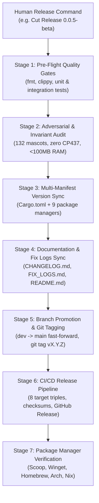

# Forgum Autonomous Release Standard Operating Procedure (RELEASE_SOP.md)

> **Purpose:** Canonical flight checklist and automated execution protocol for cutting and publishing new releases of Forgum.  
> **Authority Mandate:** Strict adherence to [`AGENTS.md`](file:///Z:/Projects/Forgum/AGENTS.md) Mandate J (Zero autonomous version bumping or tagging without explicit human command).  
> **Target Branches:** `dev` (Primary Development) $\to$ `main` (Production Release).  

---

## 1. Release Architecture & Pipeline Overview



---

## 2. Stage-by-Stage Release Execution Protocol

### Stage 1: Pre-Flight Quality Gates & Linters
Before modifying any version numbers, the entire workspace must pass all local quality gates with zero errors and zero warnings:

```powershell
# 1.1 Verify standard formatting
cargo fmt --check

# 1.2 Verify zero compiler and clippy warnings
cargo clippy --workspace --all-targets -- -D warnings

# 1.3 Verify complete unit and integration test suite
cargo test --workspace
```
*Gating condition:* If any test or clippy warning fails, release execution halts immediately until remediated.

---

### Stage 2: Adversarial & Memory Ceiling Invariants
The release candidate must satisfy all core Forgum architectural invariants:

```powershell
# 2.1 Mascot inventory & CP437 mojibake invariants
cargo test -p forgum-engine --test adversarial_invariants

# 2.2 Cartoon kinematics & boundary modes
cargo test -p forgum-engine --test cartoon_kinematics

# 2.3 CLI flags and scene configuration
cargo test -p forgum-engine --test cli_args

# 2.4 CFG containment (platform isolation)
cargo test -p forgum-engine --test cfg_containment

# 2.5 Memory budget ceiling (<100MB RAM)
cargo test -p forgum-engine --test memory_budget
```
*Gating condition:* Must confirm 132 physical mascot files, 0 occurrences of `Γÿ` or U+2600..=U+263F collision glyphs, and zero heap allocations in hot render loops.

---

### Stage 3: Multi-Manifest Version Synchronization
When the human user explicitly commands a version increment to `vX.Y.Z-beta` (e.g. `0.0.5-beta`), synchronize the version across all workspace crates and packaging manifests:

1. **Root `Cargo.toml`**:
   ```toml
   [workspace.package]
   version = "0.0.5-beta"
   ```
2. **Scoop Manifest (`packaging/scoop/forgum.json`)**:
   - Update `"version": "0.0.5-beta"`.
   - Update download URLs to point to `v0.0.5-beta` release binaries.
3. **Winget Manifests (`packaging/winget/`)**:
   - Update `PackageVersion: 0.0.5-beta` across version, installer, and locale manifests.
4. **Chocolatey Manifest (`packaging/choco/forgum.nuspec`)**:
   - Update `<version>0.0.5-beta</version>`.
5. **Arch Linux PKGBUILD (`packaging/pacman/PKGBUILD`)**:
   - Update `pkgver=0.0.5.beta` (normalized for Arch version rules).
6. **RPM Spec (`packaging/rpm/forgum.spec`)**:
   - Update `Version: 0.0.5` and `Release: 1.beta`.
7. **Debian Control (`packaging/deb/DEBIAN/control`) & Changelog**:
   - Update version string to `0.0.5-beta`.
8. **Nix Derivation (`packaging/nix/package.nix`)**:
   - Update `version = "0.0.5-beta"`.

---

### Stage 4: Documentation & Fix Logs Synchronization
1. **Update [`FIX_LOGS.md`](file:///Z:/Projects/Forgum/FIX_LOGS.md)**:
   - Ensure all defects remediated during this milestone are logged with root cause, fix, and verification command.
2. **Update [`CHANGELOG.md`](file:///Z:/Projects/Forgum/CHANGELOG.md)**:
   - Add new version heading `## [0.0.5-beta] - YYYY-MM-DD` following Keep-a-Changelog standard.
   - Categorize items under `### Added`, `### Changed`, `### Fixed`, `### Removed`.
3. **Update [`README.md`](file:///Z:/Projects/Forgum/README.md)**:
   - Verify all version badges, quick-install one-liners, and feature descriptions reflect the release.

---

### Stage 5: Branch Promotion & Git Tagging Protocol
Once all manifests and documentation are committed atomically to `dev`:

```powershell
# 5.1 Push dev to remote
git push origin dev

# 5.2 Fast-forward main from dev
git checkout main
git merge --ff-only dev
git push origin main

# 5.3 Return to dev branch
git checkout dev

# 5.4 Tag the release on main (ONLY upon explicit human command)
git tag -a v0.0.5-beta -m "Release v0.0.5-beta: Gait limb stroke sanitization, high-entropy PRNG & incommensurate particle physics, and universal unicode engine"
git push origin v0.0.5-beta
```

---

### Stage 6: CI/CD Pipeline Monitoring & Release Asset Verification
Pushing tag `vX.Y.Z-beta` triggers `.github/workflows/release.yml`. Monitor the release workflow:

```powershell
# 6.1 Check workflow run status
gh run list --workflow=release.yml --limit 3

# 6.2 Watch running release job
gh run watch <run-id>
```

Verify that all 8 cross-platform binary archives are uploaded to the GitHub Release:
1. `forgum-x86_64-unknown-linux-gnu.tar.gz`
2. `forgum-x86_64-unknown-linux-musl.tar.gz`
3. `forgum-aarch64-unknown-linux-gnu.tar.gz`
4. `forgum-aarch64-unknown-linux-musl.tar.gz`
5. `forgum-x86_64-apple-darwin.tar.gz`
6. `forgum-aarch64-apple-darwin.tar.gz`
7. `forgum-x86_64-pc-windows-msvc.zip`
8. `forgum-aarch64-pc-windows-msvc.zip`
9. `sha256sums.txt` (cryptographic verification checksums)

---

### Stage 7: Post-Release Package Manager Channel Verification
1. **GitHub Release Check**:
   ```powershell
   gh release view v0.0.5-beta
   ```
2. **In-Tree Auto-Updater Verification**:
   ```powershell
   forgum update --check
   ```
3. **Verify Installer One-Liners**:
   - Linux / macOS: `curl -sSL https://raw.githubusercontent.com/HKDevLoops/Forgum/main/install.sh | bash`
   - Windows PowerShell: `irm https://raw.githubusercontent.com/HKDevLoops/Forgum/main/install.ps1 | iex`

---

## 3. Emergency Rollback Protocol

If a release archive contains a critical defect or broken binary:
1. **Never mutate a pushed release tag**: Git tags are immutable.
2. **Yank / Draft Release**: Mark the GitHub Release as Draft or Pre-release.
3. **Cut Patch Release**: Apply the fix on `dev`, merge to `main`, and increment the patch version (e.g. `v0.0.5-beta`), following this SOP from Stage 1.
