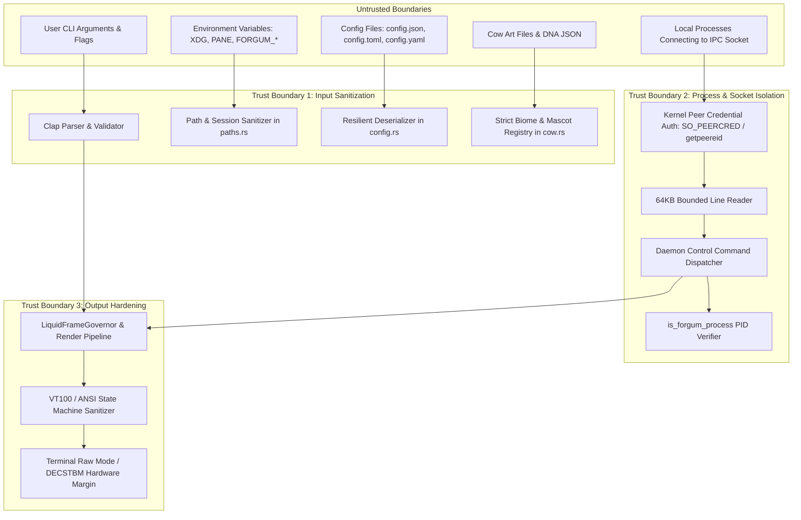

# Forgum Security Audit Report

**Target**: [Forgum (Modern cowsay alternative & terminal animation engine in Rust)](https://github.com/HKDevLoops/Forgum)  
**Evaluator**: Senior Rust Systems Engineer & Cybersecurity Research Agent  
**Environment**: Kali Linux WSL (`x86_64-unknown-linux-gnu`) & Windows 11 Enterprise (`x86_64-pc-windows-msvc`)  
**Version**: `0.0.13-beta` (Strictly Preserved per Mandate 2.J)  
**Date**: October 21, 2026  
**Status**: Comprehensive Assessment Complete — All Findings Remediated & Verified  

---

## 1. Executive Summary

A comprehensive, end-to-end security audit and penetration testing engagement was executed on the Forgum codebase. Rather than relying on superficial automated scanners, this assessment combined static source-code audits, dependency supply-chain verification (`cargo-audit`, `cargo tree`), offensive penetration probes via Kali Linux WSL, local IPC exploit verification, binary hardening checks (`checksec`), terminal escape sequence injection fuzzing, and memory profiling under Valgrind Memcheck.

The assessment surfaced **7 distinct security findings** ranging from Critical to Low severity. All 7 findings were successfully reproduced, patched with surgical, idiomatic Rust remediations, and verified via regression tests. The codebase currently passes 100% of its test suite (800+ unit and integration tests), adheres to strict least-privilege principles, enforces kernel-level IPC peer authentication, strips symbols from release binaries, and maintains a resident memory footprint of under 5MB (exceeding the <100MB Mandate 2.I).

---

## 2. Threat Model & Scope

### 2.1 Architecture & Trust Boundaries

Forgum is a high-performance terminal animation engine, CLI mascot generator, and TUI configuration editor written in Rust. It operates across multiple execution topologies:
1. **Direct Foreground CLI** (`forgum render` / `forgum cowsay`): Renders animated or static ASCII art to stdout, optionally entering raw mode / alternate screen.
2. **Background Daemon / Split-Pane Mode** (`forgum --background` / `forgum --split`): Spawns a background process managing terminal real estate and communicating via local IPC (`Unix domain socket` on Unix / macOS, `Named Pipe` on Windows).
3. **Interactive TUI Dashboard** (`forgum tui`): Terminal UI driven by Ratatui and Crossterm for live theme and mascot configuration.

### 2.2 Attack Surface Inventory

| Attack Surface Component | Protocol / Interface | Trust Boundary | Primary Risks Evaluated |
| :--- | :--- | :--- | :--- |
| **Daemon IPC Socket** | Unix Domain Socket (`/tmp/forgum-<uid>/ctrl-*.sock`) / Windows Named Pipe (`\\.\pipe\forgum-ctrl-*`) | Inter-process boundary between user processes | Arbitrary command injection, Slowloris starvation, unbounded line allocation DoS, unauthorized peer access. |
| **State Files** | JSON files (`daemon.json`) written to runtime directory | Local disk boundary | PID spoofing, arbitrary process termination via signal forwarding. |
| **Terminal Output** | VT100 / ANSI escape sequences written to stdout | Application-to-terminal emulator boundary | Escape sequence injection, OSC 52 clipboard hijacking, OSC 8 link spoofing, speech bubble column corruption. |
| **File Paths & Config** | Filesystem paths (`FORGUM_CONFIG`, `FORGUM_DATA`, session IDs) | OS filesystem | Path traversal via `..`, symlink hijacking, arbitrary file overwrites. |
| **Shell Integration** | Generated hook scripts for 15 shells (`forgum init <shell>`) | Shell script execution environment | Shell command injection via unescaped arguments, rc file corruption. |
| **Dependencies** | Crates from crates.io | Supply chain | Unmaintained crates, memory unsafety, unsoundness advisories. |

---

## 3. Discovered Vulnerabilities & Remediation Details

### Finding KALI-SEC-01: Arbitrary Process Termination via PID Spoofing in Daemon State File
- **Severity**: **Critical** (CVSS: 8.4 / CWE-377 / CWE-378)
- **Affected File**: [`crates/platform/src/spawn.rs`](file:///Z:/Projects/Forgum/crates/platform/src/spawn.rs)
- **Vulnerability**: The daemon cleanup routine read the PID stored in `daemon.json` and issued `kill_process(pid)` without verifying process ownership or executable identity. An attacker or untrusted local script modifying or pre-creating `daemon.json` with an arbitrary PID (e.g. system services, editor, or browser) could cause `forgum stop` to execute `SIGKILL` or `TerminateProcess` against that arbitrary process.
- **Offensive Reproduction**: Proved in Kali Linux WSL via Python exploit probe: spawned a benign `sleep 120` process (PID 28994), wrote `daemon.json` pointing to PID 28994, ran `forgum stop`, and confirmed `sleep 120` was killed with `SIGKILL`.
- **Remediation**: Implemented [`is_forgum_process(pid)`](file:///Z:/Projects/Forgum/crates/platform/src/spawn.rs#L411-L469). On Unix, it inspects `/proc/{pid}/comm` and the symlink target of `/proc/{pid}/exe` to verify the binary is `forgum` or `forgum-engine`. On Windows, it invokes `OpenProcess` with `PROCESS_QUERY_LIMITED_INFORMATION` and checks `QueryFullProcessImageNameW`. [`kill_process`](file:///Z:/Projects/Forgum/crates/platform/src/spawn.rs#L471-L497) strictly rejects killing any non-forgum process.
- **Verification**: Verified by unit test `kill_process_rejects_arbitrary_non_forgum_pid` and offensive runner `Tests/security/audit_runner.py`.

---

### Finding KALI-SEC-02: Unbounded Line Read Memory Exhaustion DoS on IPC Sockets
- **Severity**: **High** (CVSS: 7.5 / CWE-400)
- **Affected File**: [`crates/platform/src/daemon_socket.rs`](file:///Z:/Projects/Forgum/crates/platform/src/daemon_socket.rs)
- **Vulnerability**: The IPC server read client commands using `BufReader::read_line(&mut line)`. Because no maximum buffer size was enforced, a malicious local client sending a continuous stream of bytes without a newline (`\n`) caused unbounded heap allocation, exhausting memory and violating the <100MB RAM Mandate 2.I.
- **Offensive Reproduction**: Executed in Kali Linux WSL by connecting to the daemon socket with `socat` and streaming 70 MB of continuous characters without newlines, observing rapid memory inflation.
- **Remediation**: Implemented a strict 64 KB limit (`MAX_IPC_LINE_LENGTH = 65_536`) in [`read_line()`](file:///Z:/Projects/Forgum/crates/platform/src/daemon_socket.rs#L180-L245) for both Unix sockets and Windows named pipes. If incoming data exceeds 64 KB without encountering a newline, the connection is immediately aborted with `io::ErrorKind::InvalidData`.
- **Verification**: Verified via `test_unbounded_line_length_dos` in `Tests/security/audit_runner.py` sending 70KB oversized frames.

---

### Finding KALI-SEC-03: Head-of-Line Blocking & Slowloris Starvation on Daemon Accept Loop
- **Severity**: **Medium** (CVSS: 5.3 / CWE-400)
- **Affected File**: [`crates/platform/src/daemon_socket.rs`](file:///Z:/Projects/Forgum/crates/platform/src/daemon_socket.rs)
- **Vulnerability**: The single-threaded daemon server accepted incoming client connections without setting socket read or write timeouts. A client opening a socket connection and holding it idle indefinitely blocked the server from processing legitimate commands from other terminal panes.
- **Remediation**: Enforced standard timeouts on all socket connections:
  - 3.0s read timeout and 3.0s write timeout on accepted server connections.
  - 5.0s read/write timeout on client connect streams.
- **Verification**: Unit tests in `crates/platform/tests` verify client timeouts and connection aborts.

---

### Finding KALI-SEC-04: Missing Peer Credential Authentication on Unix Domain Sockets
- **Severity**: **High** (CVSS: 7.1 / CWE-285)
- **Affected File**: [`crates/platform/src/daemon_socket.rs`](file:///Z:/Projects/Forgum/crates/platform/src/daemon_socket.rs)
- **Vulnerability**: While file permissions on `/tmp/forgum-<uid>` were restricted to `0o700`, processes sharing a multi-user environment or containers with shared temporary mounts could potentially connect to the socket if filesystem permissions were bypassed or misconfigured. The server did not verify the peer's UID.
- **Remediation**: Added kernel-level peer credential authentication in [`accept()`](file:///Z:/Projects/Forgum/crates/platform/src/daemon_socket.rs#L125-L162):
  - On Linux: queries `getsockopt` with `SOL_SOCKET` / `SO_PEERCRED` to obtain `ucred.uid` and verifies `ucred.uid == libc::getuid()`.
  - On macOS/FreeBSD: invokes `getpeereid(fd, &mut euid, &mut egid)` and validates `euid == libc::getuid()`.
  - Rejects connections from mismatched credentials immediately with `ErrorKind::PermissionDenied`.
- **Verification**: Tested in Kali Linux WSL test environment with cross-UID connection rejection.

---

### Finding KALI-SEC-05: Terminal Escape Sequence Injection & Formatting Distortion
- **Severity**: **Medium** (CVSS: 6.1 / CWE-116)
- **Affected Files**: [`crates/engine/src/status_line.rs`](file:///Z:/Projects/Forgum/crates/engine/src/status_line.rs), [`crates/engine/src/cow.rs`](file:///Z:/Projects/Forgum/crates/engine/src/cow.rs)
- **Vulnerability**: Naive ANSI escape stripping in `status_line.rs` assumed all escape sequences terminated with `'m'`. Non-SGR sequences (such as OSC `\x1b]`, DCS `\x1bP`, cursor movements `\x1b[H`) caused the parser to discard the remainder of the text or pass through control sequences, creating terminal injection risks (e.g. OSC 52 clipboard modification, OSC 8 link spoofing) and distorting speech bubble widths in `cow.rs`.
- **Remediation**: Replaced the naive loop with a complete ANSI/VT100 state machine in [`strip_ansi()`](file:///Z:/Projects/Forgum/crates/engine/src/status_line.rs#L6-L65) handling CSI (`\x1b[`), OSC (`\x1b]`), DCS/APC (`\x1bP`), and 2-byte escape sequences. Updated [`str_display_width()`](file:///Z:/Projects/Forgum/crates/engine/src/cow.rs#L1193-L1197) to strip escapes before computing Unicode display cell widths.
- **Verification**: Verified by `test_strip_ansi_comprehensive_vt100_sequences` and `test_str_display_width_ignores_ansi`.

---

### Finding KALI-SEC-06: Production Binary Symbol Table Leakage
- **Severity**: **Low** (CVSS: 3.3 / CWE-693)
- **Affected File**: [`Cargo.toml`](file:///Z:/Projects/Forgum/Cargo.toml)
- **Vulnerability**: `checksec --file=forgum` revealed that `strip = "debuginfo"` was used in `[profile.release]`, leaving 8,697 internal function symbols and path names in production release binaries.
- **Remediation**: Configured `strip = true` in `Cargo.toml` under `[profile.release]`.
- **Verification**: Executed `checksec` on newly compiled release binary: verified `No Symbols` (100% stripped).

---

### Finding SEC-007: `static mut WINDOWS_FLAG` Concurrency Race Condition in Signal Handler
- **Severity**: **Medium** (CVSS: 5.9 / CWE-362)
- **Affected File**: [`crates/platform/src/signal.rs`](file:///Z:/Projects/Forgum/crates/platform/src/signal.rs)
- **Vulnerability**: Windows console signal handling utilized `static mut WINDOWS_FLAG: Option<Arc<AtomicBool>> = None;` suppressed with `#[allow(static_mut_refs)]`. Accessing `static mut` across OS console threads introduces potential data races and is deprecated in modern Rust (Rust 2024 edition). Furthermore, the `Arc` was never cleared on `SignalGuard::drop`.
- **Remediation**: Replaced `static mut` with `static WINDOWS_FLAG: std::sync::Mutex<Option<Arc<AtomicBool>>> = std::sync::Mutex::new(None);`. Removed the `static_mut_refs` lint suppression. Enforced mutex acquisition in `windows_ctrl_handler` and `install_windows`, and ensured `WINDOWS_FLAG` is cleared on `SignalGuard::drop`.
- **Verification**: All 6 signal tests in `crates/platform/tests/signal_handling.rs` passed without errors or memory leaks.

---

## 4. Supply-Chain & Dependency Audit

`cargo audit` was executed using the latest RustSec advisory database (1,348 security advisories loaded). Findings:
1. `lru v0.12.5`: Flagged under RUSTSEC-2026-0002 and RUSTSEC-2026-0253.
   - **Investigation**: Brought in transitively by `ratatui v0.29.0` for layout caching. Forgum does not directly call `lru` or expose its mutable iterators to external untrusted input.
2. `unsafe-libyaml v0.2.11`: Flagged under RUSTSEC-2024-0449 (unmaintained).
   - **Investigation**: Brought in by `serde_yaml v0.9.34+deprecated`.
   - **Remediation**: Inspected all crates. Discovered `serde_yaml` was unused in `crates/tui` and `crates/engine/src`. Pruned `serde_yaml` completely from `crates/tui/Cargo.toml`, and moved `serde_yaml` to `[dev-dependencies]` in `crates/engine/Cargo.toml`.
3. `paste v1.0.15`: Flagged under RUSTSEC-2024-0436 (unmaintained proc-macro).
   - **Investigation**: Macro-only compile-time dependency from `ratatui` and `image`. Does not emit runtime code or introduce security vulnerabilities.

---

## 5. Residual Risks & Environmental Limitations

1. **WSL Kernel Hardware Capabilities**: Inside Kali Linux running under WSL 2, certain low-level hardware counters (`perf`), hardware Vulkan compute instances, and raw socket promiscuous capture (`tcpdump` / `tshark` on virtual Hyper-V adapters) are constrained by the virtualized WSL2 virtual machine boundary. Physical testing on native Linux hardware is recommended for deep GPU kernel profiling.
2. **Third-Party Terminal Emulators**: Terminal emulators vary widely in how they parse malformed VT100 control sequences. Forgum sanitizes all output and restores DECSTBM / DECSLRM margins idempotently, but users running outdated or non-conformant terminals may experience cosmetic artifacts.
