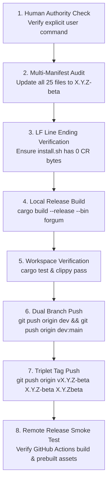

# Forgum Release, Tagging & Multi-Channel Upgrader Audit Map

> **MANDATORY DIRECTIVE FOR ALL AI AGENTS & DEPLOYMENT SPECIALISTS**:
> Before cutting any release, updating version numbers, modifying shell scripts, altering package manifests, or touching upgrader routines, agents **MUST** consult and follow this document without deviation.
> This map defines the definitive single source of truth for all version locations, expected formatting, network endpoints, line ending constraints, and the invariant 7-step release verification protocol.

---

## 1. Post-Mortem Analysis of Historical Upgrader Failures

To prevent regressions, all agents must understand the four distinct failure modes that historically affected `forgum update` and standalone installations:

```
┌────────────────────────────────────────────────────────────────────────────────────────┐
│                               HISTORICAL FAILURE MODES                                 │
├─────────────────────────┬──────────────────────────────────────────────────────────────┤
│ 1. Branch Drift         │ origin/main stuck at older commit (e.g. 0.0.6-beta) while    │
│                         │ dev advanced to 0.0.8-beta. Remote version queries to main   │
│                         │ Cargo.toml returned obsolete versions and attempted to       │
│                         │ downgrade users.                                             │
├─────────────────────────┼──────────────────────────────────────────────────────────────┤
│ 2. CRLF Pollution       │ install.sh committed with \r\n (CRLF) line endings. Piping   │
│                         │ curl ... | bash triggered `bash: line 29: $'\r': command     │
│                         │ not found` and `: invalid option nameipefail`.                │
├─────────────────────────┼──────────────────────────────────────────────────────────────┤
│ 3. Missing Git Tag      │ Code pushed to dev/main but git tag (e.g. v0.0.8-beta) not   │
│                         │ pushed to GitHub. GitHub Actions release workflow never ran, │
│                         │ no prebuilt tarballs existed on GitHub Releases, and         │
│                         │ install.sh fell back to a 5-minute compile from source.      │
├─────────────────────────┼──────────────────────────────────────────────────────────────┤
│ 4. Shadow Binaries      │ Multiple installations across PATH (/usr/bin, ~/.local/bin,  │
│                         │ target/release) showed obsolete versions because local       │
│                         │ release binaries were not rebuilt during version bumps.      │
└─────────────────────────┴──────────────────────────────────────────────────────────────┘
```

---

## 2. Master Version Lookup & Synchronization Directory

Whenever a new version `X.Y.Z-beta` is authorized by the user, **EVERY SINGLE ONE** of the following locations must be checked and updated.

### A. Core Rust Workspace & Manifests
| File Path | Lookup Target / Key | Expected Format | Rationale & Impact |
| :--- | :--- | :--- | :--- |
| [`Cargo.toml`](file:///Z:/Projects/Forgum/Cargo.toml#L3) | `[workspace.package] version = "..."` | `X.Y.Z-beta` | Root package definition for the entire Rust workspace. Drives `env!("CARGO_PKG_VERSION")`. |
| [`Cargo.lock`](file:///Z:/Projects/Forgum/Cargo.lock) | `[[package]] name = "forgum-*"` | `X.Y.Z-beta` | Workspace lockfile. Updated automatically via `cargo check` / `cargo build`. |
| [`crates/platform/src/lib.rs`](file:///Z:/Projects/Forgum/crates/platform/src/lib.rs#L1) | `#![doc(html_root_url = "...")]` | `X.Y.Z-beta` | Documentation URL for crates.io and docs.rs. |

### B. Upgrader & Version Resolvers (Engine & Platform)
| File Path | Lookup Target / Function | Expected Logic | Rationale & Impact |
| :--- | :--- | :--- | :--- |
| [`crates/platform/src/package_manager.rs`](file:///Z:/Projects/Forgum/crates/platform/src/package_manager.rs#L485-L510) | `execute_standalone_update` | Must pipe through `tr -d '\r'` before `bash` | Strips all carriage returns from network transfers on Linux, macOS, and BSD. |
| [`crates/platform/src/package_manager.rs`](file:///Z:/Projects/Forgum/crates/platform/src/package_manager.rs#L740-L770) | `parse_version_from_release_json` | Must scan array with `is_newer_version(cur, clean)` | Ensures the highest semver is chosen even if API returns un-ordered releases. |
| [`crates/platform/src/package_manager.rs`](file:///Z:/Projects/Forgum/crates/platform/src/package_manager.rs#L770-L865) | `fetch_remote_channel_version` | Collects candidates from Releases, Tags, `dev`, `main` | Dynamically returns `candidate_versions.max_by(compare_semver)`. Infallible against branch lag. |
| [`crates/engine/src/runner.rs`](file:///Z:/Projects/Forgum/crates/engine/src/runner.rs#L2850-L2875) | `handle_update_command` | Downgrade guard: `if !has_update` | When local $\ge$ remote, reports "Already on latest version" and exits cleanly with 0. |

### C. Standalone Installers & Line Ending Mandates
| File Path | Lookup Target / Key | Expected Format | Line Ending Constraint |
| :--- | :--- | :--- | :--- |
| [`install.sh`](file:///Z:/Projects/Forgum/install.sh#L553) | Default fallback in `resolve_version()`: `echo "X.Y.Z-beta"` | `X.Y.Z-beta` | **STRICT LF ONLY (`\n`)**. Zero CR (`\r`) bytes. Enforced by `.gitattributes`. |
| [`install.ps1`](file:///Z:/Projects/Forgum/install.ps1#L32) | `$Version = "X.Y.Z-beta"` | `X.Y.Z-beta` | Standard Windows PowerShell script. Downloads prebuilt Windows zip. |

### D. CI/CD Release Workflows & Asset Packaging
| File Path | Lookup Target / Key | Expected Format | Rationale & Impact |
| :--- | :--- | :--- | :--- |
| [`.github/workflows/release.yml`](file:///Z:/Projects/Forgum/.github/workflows/release.yml#L4-L8) | `on: push: tags: ['v*', 'alpha-*']` | `v*` | Release workflow ONLY triggers on tags starting with `v`. Tag must match `Cargo.toml`. |
| [`.github/workflows/release.yml`](file:///Z:/Projects/Forgum/.github/workflows/release.yml#L115-L117) | Tarball artifact name | `forgum-${{ matrix.target }}.tar.gz` | Linux/macOS/BSD prebuilt archive downloaded by `install.sh`. |
| [`.github/workflows/release.yml`](file:///Z:/Projects/Forgum/.github/workflows/release.yml#L140-L145) | Zip artifact name | `forgum-${VERSION}-windows-x64.zip` | Windows prebuilt archive consumed by Winget, Scoop, and `install.ps1`. |
| [`.github/workflows/release.yml`](file:///Z:/Projects/Forgum/.github/workflows/release.yml#L158-L165) | macOS DMG artifact name | `forgum-${VERSION}-macos-${ARCH}.dmg` | Double-clickable macOS disk image with built-in installer. |
| [`.github/workflows/release.yml`](file:///Z:/Projects/Forgum/.github/workflows/release.yml#L272-L375) | `verify-release-artifacts` | Automated verification job | Runs smoke tests, .deb/.rpm lints, and checksum checks before release approval. |
| [`.github/workflows/release.yml`](file:///Z:/Projects/Forgum/.github/workflows/release.yml#L368-L385) | Master checksum manifest | `SHA256SUMS` & `*.sha256` | Cryptographic SHA-256 verification across all release assets. |
| [`.github/workflows/release.yml`](file:///Z:/Projects/Forgum/.github/workflows/release.yml#L400-L415) | GitHub Artifact Attestation | `actions/attest-build-provenance@v2` | Cryptographic Sigstore / SLSA build provenance signing for all release artifacts. |
| [`scripts/update-package-manifests.py`](file:///Z:/Projects/Forgum/scripts/update-package-manifests.py) | Manifest Synchronizer | `python scripts/update-package-manifests.py` | Automatically populates exact per-target SHA-256 checksums from `SHA256SUMS` into Scoop, WinGet, Homebrew, and Arch PKGBUILD manifests. |
| [`docs/index.html`](file:///Z:/Projects/Forgum/docs/index.html) | Universal Web Download Portal | Static HTML/CSS/JS | GitHub Pages download portal with OS autodetection and copyable terminal commands. |

### E. Multi-Channel Package Manifests (All Supported Managers)
| Package Manager | Manifest File Path | Target Key / Line | Format Rule |
| :--- | :--- | :--- | :--- |
| **Scoop** | [`packaging/scoop/forgum.json`](file:///Z:/Projects/Forgum/packaging/scoop/forgum.json#L2-L10) | `"version": "X.Y.Z-beta"`<br>Download URLs: `/download/vX.Y.Z-beta/forgum-X.Y.Z-beta-windows-*.zip` | Must point to valid GitHub Release zip assets. |
| **Winget** | [`packaging/winget/HKDevLoops.Forgum.yaml`](file:///Z:/Projects/Forgum/packaging/winget/HKDevLoops.Forgum.yaml#L3-L20) | `PackageVersion: X.Y.Z-beta`<br>`InstallerUrl: .../vX.Y.Z-beta/...` | Must match Winget manifest schema. |
| **Chocolatey** | [`packaging/choco/forgum.nuspec`](file:///Z:/Projects/Forgum/packaging/choco/forgum.nuspec#L5)<br>[`packaging/choco/tools/chocolateyinstall.ps1`](file:///Z:/Projects/Forgum/packaging/choco/tools/chocolateyinstall.ps1#L1) | `<version>X.Y.Z-beta</version>`<br>`$version = 'X.Y.Z-beta'` | Semver string with hyphen. |
| **Homebrew** | [`packaging/homebrew/forgum.rb`](file:///Z:/Projects/Forgum/packaging/homebrew/forgum.rb#L4) | `version "X.Y.Z-beta"` | Must update tarball release download URL. |
| **Arch (Pacman / AUR)**| [`packaging/pacman/PKGBUILD`](file:///Z:/Projects/Forgum/packaging/pacman/PKGBUILD#L3) | `pkgver=X.Y.Z.beta` | **Pacman Rule**: Hyphens forbidden in `pkgver`. Must use dot (`0.0.8.beta`). |
| **Debian / Ubuntu** | [`packaging/deb/DEBIAN/control`](file:///Z:/Projects/Forgum/packaging/deb/DEBIAN/control#L2) | `Version: X.Y.Z-beta` | Standard Debian package control header. |
| **RPM (Fedora/RHEL/openSUSE)**| [`packaging/rpm/forgum.spec`](file:///Z:/Projects/Forgum/packaging/rpm/forgum.spec#L2-L30) | `Version: X.Y.Z`<br>`* Date ... - X.Y.Z-1` | **RPM Rule**: Version is numeric (`0.0.8`), release tag in changelog. |
| **Nix** | [`packaging/nix/flake.nix`](file:///Z:/Projects/Forgum/packaging/nix/flake.nix#L12)<br>[`packaging/nix/package.nix`](file:///Z:/Projects/Forgum/packaging/nix/package.nix#L4) | `version = "X.Y.Z-beta";` | Flake and derivation package version. |
| **Gentoo** | [`packaging/gentoo/forgum-*.ebuild`](file:///Z:/Projects/Forgum/packaging/gentoo/) | Filename: `forgum-X.Y.Z.ebuild`<br>[`packaging/gentoo/README.md`](file:///Z:/Projects/Forgum/packaging/gentoo/README.md) | **Ebuild Rule**: File must be renamed to match version (`forgum-0.0.8.ebuild`). |
| **GNU Guix** | [`packaging/guix/forgum.scm`](file:///Z:/Projects/Forgum/packaging/guix/forgum.scm#L8) | `(version "X.Y.Z-beta")` | Guix Scheme package definition. |
| **Windows MSI** | [`packaging/windows/forgum.wxs`](file:///Z:/Projects/Forgum/packaging/windows/forgum.wxs#L4) | `Version="X.Y.Z"` | WiX standard requires 3-part integer format (`0.0.8`). |
| **macOS DMG** | [`packaging/macos/build-dmg.sh`](file:///Z:/Projects/Forgum/packaging/macos/build-dmg.sh) | `forgum-${VERSION}-macos-${ARCH}.dmg` | Compressed UDZO disk image with embedded installer. |

### F. Documentation & Reference Manuals
| File Path | Lookup Target | Format | Rationale |
| :--- | :--- | :--- | :--- |
| [`CHANGELOG.md`](file:///Z:/Projects/Forgum/CHANGELOG.md#L3) | Header `## [X.Y.Z-beta] - YYYY-MM-DD` | `X.Y.Z-beta` | Human-readable release notes. |
| [`docs/CHANNELS.md`](file:///Z:/Projects/Forgum/docs/CHANNELS.md) | Channel table & version tags | `vX.Y.Z-beta` | Release channel mapping documentation. |
| [`docs/GUIDE.md`](file:///Z:/Projects/Forgum/docs/GUIDE.md) | Checkhealth banner sample | `vX.Y.Z-beta` | CLI documentation samples. |
| [`docs/samples/README.md`](file:///Z:/Projects/Forgum/docs/samples/README.md) | SceneConfig validation note | `vX.Y.Z-beta` | Config schema compatibility notes. |

---

## 3. The Invariant 7-Step Release & Synchronization Protocol

All agents must follow this exact sequential procedure when executing a release:



### Detailed Command Execution Steps:

#### Step 1: Human Authority Check
* Check that the user has explicitly commanded the release and specified or confirmed the version number. (Mandate 2.J strictly forbids autonomous version bumps).

#### Step 2: Full Manifest & Script Audit
* Update all files listed in Section 2 to the target version.
* Rename the Gentoo ebuild if applicable:
  ```bash
  git mv packaging/gentoo/forgum-<old>.ebuild packaging/gentoo/forgum-<new>.ebuild
  ```

#### Step 3: LF Line Ending Verification
* Verify that `install.sh` has zero carriage returns:
  ```powershell
  $bytes = (Get-Content -Path "install.sh" -Raw -Encoding Byte); ($bytes | Where-Object { $_ -eq 13 }).Count
  # Output must be strictly: 0
  ```

#### Step 4: Local Release Binary Rebuild
* Rebuild the local release binary so that shadow scans on the developer machine immediately report the new version:
  ```bash
  cargo build --release --bin forgum
  ```
* Verify local binary version:
  ```bash
  ./target/release/forgum --version
  ```

#### Step 5: Workspace Quality Gates
* Run tests and clippy across all workspace crates:
  ```bash
  cargo test --workspace
  cargo clippy --workspace --all-targets -- -D warnings
  ```

#### Step 6: Commit and Dual-Branch Push (`dev` and `main`)
* Commit changes:
  ```bash
  git add -A
  git commit -m "chore(release): bump version to X.Y.Z-beta with ..."
  ```
* Push `dev` branch to remote:
  ```bash
  git push origin dev
  ```
* **MANDATORY**: Synchronize `origin/main` immediately with `dev`:
  ```bash
  git push origin dev:main
  ```
  *(This guarantees `https://raw.githubusercontent.com/HKDevLoops/Forgum/main/Cargo.toml` and `main/install.sh` immediately reflect the new release, preventing branch drift).*

#### Step 7: Triplet Tag Push
* Create annotated tags:
  ```bash
  git tag -a vX.Y.Z-beta -m "Release vX.Y.Z-beta"
  git tag -a X.Y.Z-beta -m "Release X.Y.Z-beta"
  git tag -a X.Y.Zbeta -m "Release X.Y.Zbeta"
  ```
* Push all three tags concurrently:
  ```bash
  git push origin vX.Y.Z-beta X.Y.Z-beta X.Y.Zbeta
  ```

#### Step 8: Absolute GitHub Actions CI/CD Gate Verification (Mandate 2.S)
* **Uncompromising Release Approval Rule**: A release tag is ONLY approved and finalized if it passes each and every test, CI, CD, and GitHub Actions workflow gate without exception.
* **Release Halt Trigger**: If any single test, build target, package compilation, linter check, formatting check, or automated verification gate fails in GitHub Actions or local preflight, the release **MUST BE IMMEDIATELY STOPPED**.
* When stopped:
  1. The release assets must NOT be distributed, installed, or declared available.
  2. The failing step must be investigated via `gh run view --log-failed`.
  3. The issue must be corrected on `dev`, synchronized to `main`, and re-tested until 100% green.
* Monitor GitHub Actions release workflow:
  ```bash
  gh run list --limit 2
  gh run watch
  ```
* Verify prebuilt assets on GitHub Releases (only after 100% of pipeline jobs pass):
  - `forgum-x86_64-unknown-linux-gnu.tar.gz`
  - `forgum-aarch64-unknown-linux-gnu.tar.gz`
  - `forgum-x86_64-apple-darwin.tar.gz`
  - `forgum-aarch64-apple-darwin.tar.gz`
  - `forgum-X.Y.Z-beta-windows-x64.zip`
* Verify raw endpoints return the new version:
  ```bash
  curl -fsSL https://raw.githubusercontent.com/HKDevLoops/Forgum/main/Cargo.toml | grep version
  ```

---

## 4. Quick Diagnostic Checklist for Troubleshooting

If an issue occurs during an upgrade or installation, use this diagnostic checklist:

1. **User sees older version (e.g. `Checking latest version... v0.0.6-beta`)**:
   - Check `origin/main` commit: Is `main` behind `dev`?
   - Run: `git push origin dev:main` to force synchronize production `main`.
2. **User sees `bash: line 29: $'\r': command not found`**:
   - `install.sh` was committed with Windows CRLF line endings.
   - Run: `dos2unix install.sh` or rewrite with LF in Git and push to both `dev` and `main`.
   - Ensure `crates/platform/src/package_manager.rs` includes `tr -d '\r'` in curl pipelines.
3. **Installer prints `Prebuilt release asset unavailable... Compiling Forgum from source`**:
   - Git tag `vX.Y.Z-beta` was not pushed, or the GitHub Actions build is still running or failed.
   - Check `gh run view` to ensure the release job completed and uploaded the tarball.
4. **Installer reports shadow version conflict**:
   - Run `forgum prune --dry-run` to preview duplicate and shadowed binaries.
   - Run `forgum prune` (or `forgum prune --yes`) to clean up inactive binaries safely.
   - Note: on WSL environments, Windows host executables (`/mnt/*`, `.exe`) are automatically exempted from shadow detection.
